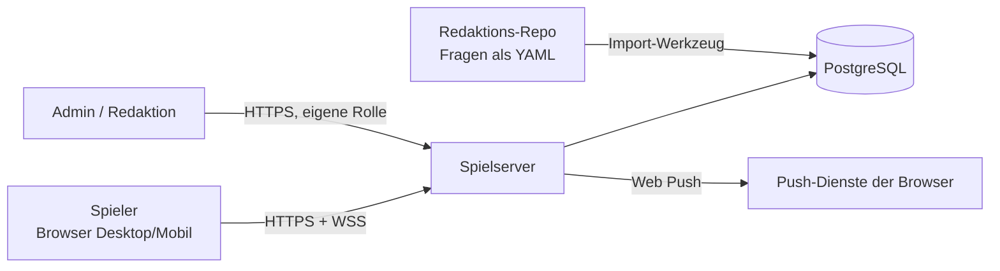
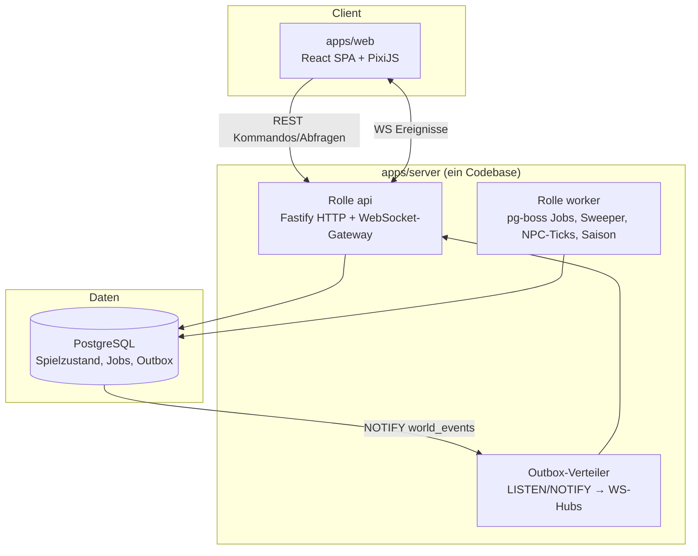
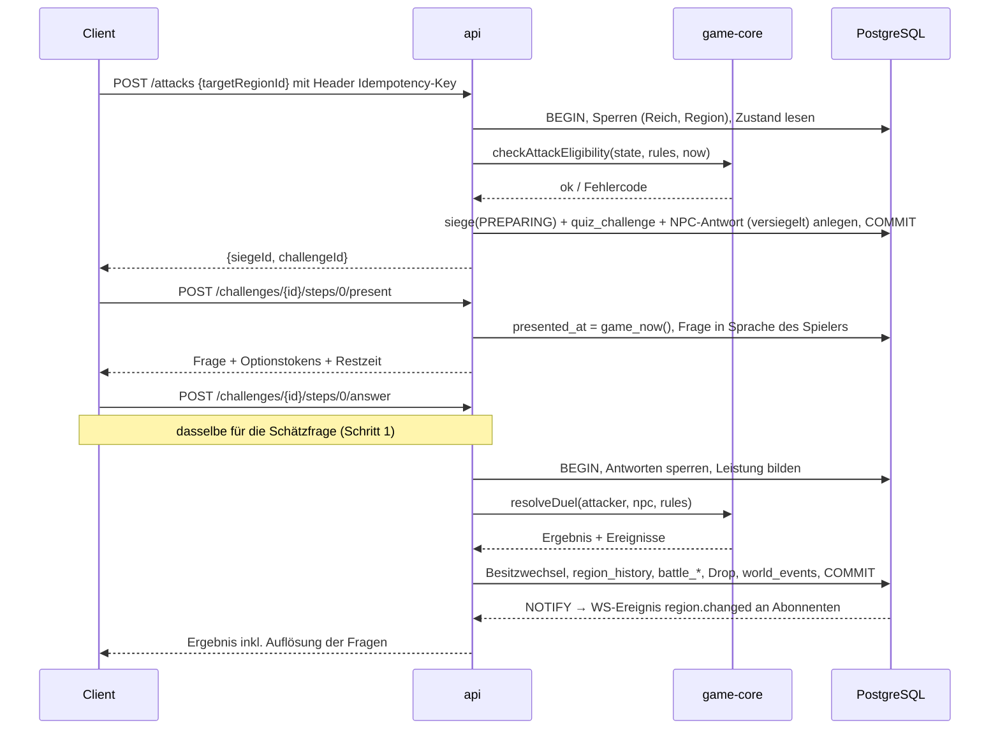

# Architekturübersicht

Bezug: Brief §12, §18, §20. Begründungen der Einzelentscheidungen stehen als ADRs in [DECISIONS.md](DECISIONS.md#architekturentscheidungen-adr).

## 1. Leitentscheidungen

1. **Modularer Monolith, zwei Prozessrollen.** Ein TypeScript-Server-Codebase mit zwei Startpunkten: `api` (HTTP + WebSocket) und `worker` (Fristen, NPC-Simulation, Saisonwechsel). Keine Microservices – das wäre für das Team und die erwartete Last Überarchitektur (Brief §20.8). Beide Rollen skalieren unabhängig horizontal.
2. **Funktionaler Kern, imperative Hülle.** Alle Spielregeln liegen in `packages/game-core` als reine, deterministische Funktionen ohne Ein-/Ausgabe. Die Server-Anwendungsschicht lädt Zustand (mit Sperren), ruft den Kern auf und schreibt das Ergebnis atomar. Dadurch sind Regeln ohne Datenbank testbar und für Simulationen wiederverwendbar.
3. **PostgreSQL ist die einzige Quelle der Wahrheit** – für Spielzustand, für dauerhafte Jobs und für **Zeit**. Fristen werden gegen die Datenbankuhr geprüft, nicht gegen die Uhr eines einzelnen Servers.
4. **Zustand plus Ereignisprotokoll statt Event Sourcing.** Aktueller Zustand in normalisierten Tabellen; jede relevante Änderung schreibt zusätzlich unveränderliche Ereignisse (`battle_events`, `region_history`, `inventory_transactions`, `audit_events`). Das reicht, um jeden strittigen Kampf zu rekonstruieren (Brief §18), ohne die Komplexität vollständigen Event Sourcings.
5. **Transaktionaler Outbox für Echtzeit.** Jede Zustandsänderung schreibt im selben Commit ein Ereignis in `world_events`. Ein Verteiler leitet diese an verbundene Clients weiter. Kein Ereignis geht verloren, keines wird für eine zurückgerollte Transaktion gesendet.
6. **Client ist Darstellung.** Der Browser darf Regeln *vorschauen* (z. B. angreifbare Nachbarn hervorheben, mit demselben `game-core`), entscheidet aber nichts (Brief §12.2).

## 2. Technologie-Stack

| Bereich | Wahl | Begründung | Verworfene Alternativen |
|---|---|---|---|
| Sprache | TypeScript (strict) überall | Brief-Präferenz, geteilte Typen Client/Server | – |
| Monorepo | pnpm Workspaces | in Umgebung vorhanden, schnell, keine zusätzliche Build-Orchestrierung nötig; Turborepo erst bei Bedarf | Nx (zu schwer), Einzelrepos |
| Frontend | React + Vite (SPA) | Spiel-Client braucht kein SSR; Vite ist schnell und einfach zu hosten (statische Dateien) | Next.js: SSR/Server-Komponenten bringen hier keinen Nutzen, aber zusätzliche Server-Komplexität |
| Kartenrenderer | PixiJS (WebGL, Canvas-Fallback) | Zehntausende Hexfelder flüssig, Viewport-Culling, Sprite-Batching | SVG (bricht bei > 2 000 Feldern ein), eigenes WebGL (zu aufwendig) |
| UI-Zustand | TanStack Query (Serverzustand) + Zustand (lokaler UI-Zustand) | klare Trennung autoritativer Daten vs. UI | Redux (mehr Boilerplate) |
|  | *Phase 1: React-Zustand und kleine Hooks, eigener Router (ADR-036); die Bibliotheken kommen, wenn Ereignisse über den WebSocket den Zustand ändern* |  |  |
| i18n UI | i18next / react-i18next, ICU-Pluralformen | Texte über Schlüssel statt im Code, auch mit nur Deutsch (ADR-023); eine weitere Sprache bleibt so ohne Umbau möglich | – |
|  | *Phase 1: eigenes typisiertes Modul mit denselben Schlüsseln (ADR-036); i18next erst mit einer zweiten Sprache* |  |  |
| HTTP-Server | Fastify | schnell, Schema-Validierung, gutes Plugin-Ökosystem, WebSocket-Plugin | Express (langsamer, weniger Typisierung), NestJS (schwergewichtig) |
| Validierung / Verträge | zod, geteilt in `packages/protocol` | ein Schema für Client, Server, Konfiguration | – |
| Echtzeit | WebSocket (`@fastify/websocket` / `ws`) | bidirektional, Browser-nativ | Socket.IO (eigenes Protokoll, nicht nötig), SSE (nur unidirektional) |
| Datenbank | PostgreSQL 16+ | Brief-Vorschlag; Transaktionen, Zeilensperren, partielle Unique-Indizes, `LISTEN/NOTIFY` | – |
| DB-Zugriff | Kysely (typisierter SQL-Builder) | SQL-nah, explizite Sperren (`FOR UPDATE`), keine versteckte Magie bei kritischen Transaktionen | Prisma (schwache Kontrolle über Sperren/Transaktionen), Drizzle (gute Option, aber weniger SQL-nah bei komplexen Constraints) |
| Migrationen | Versionierte SQL-Migrationen, nur vorwärts, in CI gegen frische DB getestet | Constraints, partielle Indizes und Funktionen sind direkt in SQL am klarsten | ORM-generierte Migrationen |
| Job-Queue | pg-boss (Postgres-basiert) | dauerhaft gespeichert, transaktional mit Spielzustand, keine zusätzliche Infrastruktur | BullMQ (braucht Redis, Jobs nicht transaktional mit DB) |
| Redis | nicht im MVP | Erst bei mehreren API-Knoten für Pub/Sub oder Rate Limiting; vorher reicht Postgres | – |
| Auth | eigene Sitzungen: zufälliges Token, gehasht in DB, `HttpOnly`-Cookie; Passwörter mit Argon2id | Datenminimierung, keine Drittanbieter-Abhängigkeit; Kontomodell offen [O-03] | Fremd-Identity-Provider (AVV, Kosten) |
| Logs / Metriken | pino (JSON-Logs), Prometheus-Endpunkt (`prom-client`), OpenTelemetry-Tracing vorbereitet | kostenlos, standardisiert | – |
| Tests | Vitest, fast-check (Property-Tests), Playwright (E2E), echtes Postgres in Integrationstests | siehe [TEST_PLAN.md](TEST_PLAN.md) | – |

## 3. Systemkontext



## 4. Prozesse und Container



- `api` und `worker` laufen im MVP als zwei Prozesse auf einem Host; der Outbox-Verteiler läuft in jedem `api`-Prozess.
- Skalierung: mehrere `api`-Prozesse hinter einem Load Balancer (WebSocket ohne Sticky Sessions möglich, da jeder Prozess alle Outbox-Ereignisse empfängt und nur an seine eigenen Verbindungen filtert). Sobald mehr als ein `api`-Prozess läuft, wird das Rate Limiting zentral geteilt (Zähler in PostgreSQL oder am Load Balancer), damit Limits nicht pro Knoten gelten. Ab etwa 5–10 API-Knoten oder hoher Ereignisrate wird Redis für Pub/Sub und Rate Limiting ergänzt.

## 5. Repository-Struktur (Zielbild)

```
apps/
  web/                 React-Client (Vite), Routen, Karte, Quiz-UI, PWA
  server/
    src/main-api.ts    Startpunkt Rolle api
    src/main-worker.ts Startpunkt Rolle worker
    src/modules/       identity, world, map, kingdom, quiz, combat, items, npc, notifications, admin
    src/infra/         db, clock, rng, outbox, jobs, logging, metrics, config
packages/
  game-core/           reine Regeln: Hex-Mathematik, Berechtigung, Duellauswertung,
                       Belagerungs-Zustandsmaschine, Drops, NPC-Antwortmodell, Ränge
  protocol/            zod-Schemas für API-DTOs, WS-Ereignisse, Regelkonfiguration
  db/                  SQL-Migrationen, generierte Tabellentypen, Testhelfer
tools/
  sim/                 Balancing-Simulationen (Items, Limits, NPC) auf Basis von game-core
  content/             Fragen-Import, Schema-Prüfung, Übersetzungsstatus-Bericht
content/questions/     Fragen als YAML (oder separates Redaktions-Repo, siehe QUIZ_ENGINE §9)
docs/
```

Abhängigkeitsregel: `game-core` hängt von nichts ab außer `protocol`-Typen; `apps/*` hängen von `packages/*` ab, nie umgekehrt. Eine Lint-Regel erzwingt das.

## 6. Module (fachliche Grenzen)

| Modul | Verantwortung | Besitzt Tabellen |
|---|---|---|
| identity | Konten, Sitzungen, Profile, Einstellungen, Löschung/Export | `users`, `sessions`, `player_profiles`, `player_settings` |
| world | Welten, Instanzen, Regeln, Saisons, Teilnahme, Spawn | `worlds`, `world_instances`, `world_rules`, `world_seasons`, `world_participants` |
| map | Regionen, Besitzzustand, Schutz, Historie, Chunk-Abfragen | `regions`, `region_state`, `region_history` |
| kingdom | Reiche, Statistiken, Hauptstadt, Totalverlust | `kingdoms`, `kingdom_statistics`, `kingdom_history` |
| quiz | Fragenbestand, Versionen, Übersetzungen, Herausforderungen, Antworten, Zeitmessung | `questions`, `question_*`, `quiz_challenges`, `quiz_answers`, `player_question_exposure` |
| combat | Kampfauswertung, Belagerungen, Limits | `sieges`, `siege_participants`, `battle_results`, `battle_events` |
| items | Itemdefinitionen, Inventar, Drops, Verbrauch, Auto-Verlängerung | `item_definitions`, `player_items`, `inventory_transactions`, `item_usage`, `reward_events` |
| npc | Fraktionen, Antwortprofile, Weltsimulation | `npc_factions`, `npc_profiles`, `npc_actions` |
| notifications | In-App-Mitteilungen, Web Push | `notifications`, `push_subscriptions` |
| admin/ops | Admin-Werkzeuge, Audit, Missbrauchssignale, Outbox | `audit_events`, `abuse_signals`, `world_events` |

Module kommunizieren innerhalb einer Transaktion über klar definierte Funktionsschnittstellen (z. B. `combat` ruft `map.transferOwnership(tx, …)` und `items.grantReward(tx, …)`), nicht über direkte Fremdtabellen-Zugriffe.

## 7. Ablauf eines Kommandos (Beispiel PvE-Eroberung)



Der PvP-Ablauf mit Frist, Timeout-Job und Wettlauf zwischen Verteidigerantwort und Fristablauf ist in [SIEGE_SYSTEM.md §4–5](SIEGE_SYSTEM.md#4-ablauf-pvp-belagerung) beschrieben.

## 8. Zeitmodell

- **Autoritative Zeit ist die Datenbankuhr.** Alle Fristvergleiche und Zeitstempel für Fristen nutzen eine SQL-Funktion `game_now()`.
  - In Produktion: `game_now() = clock_timestamp()` (Zeit der Anweisung, nicht des Transaktionsbeginns – `now()` wäre bei längeren Transaktionen ungenau).
  - In Tests/Staging: `game_now() = clock_timestamp() + Versatz` aus einer Konfigurationstabelle. So lassen sich 24-h-Fristen in Integrations- und E2E-Tests in Sekunden durchspielen, ohne Code-Pfade zu verändern. In Produktion ist der Versatz per Migration fest auf 0 und die Tabelle schreibgeschützt.
- Anwendungscode erhält Zeit über eine injizierbare `Clock`-Schnittstelle; `game-core` bekommt `now` immer als Parameter.
- Antwortzeiten (Geschwindigkeit) werden aus Server-Zeitstempeln von Präsentation und Eingang gebildet, mit begrenztem Latenzausgleich ([QUIZ_ENGINE.md §6](QUIZ_ENGINE.md#6-zeitmessung-und-latenzausgleich)).
- Alle Zeitstempel sind `timestamptz` in UTC; Darstellung in der Zeitzone des Spielers.

## 9. Zufallsmodell (auditierbar, reproduzierbar)

Alle spielrelevanten Zufallsentscheidungen (NPC-Antworten, Drops, Fragenauswahl, Spawn-Wahl bei Gleichstand) verwenden:

```
seed  = HMAC-SHA256(RNG_SECRET[key_id], purpose || ":" || entity_id)
rng   = sfc32(seed)          // kleiner, schneller, gut getesteter PRNG, versioniert als rng_version
```

- `purpose` z. B. `npc-answer`, `drop`, `question-pick`, `spawn`, `match` (Sitzverteilung, Wahlen nach Zeitablauf und Bot-Wahlen einer Partie, [MATCH_RULES.md §7](MATCH_RULES.md#7-bots-in-testpartien-und-zufall)); `entity_id` z. B. die Kampf-ID.
- Gespeichert werden `key_id`, `rng_version` und die gezogenen Werte im Ereignisprotokoll. Mit dem Geheimnis lässt sich jede Entscheidung exakt nachrechnen (Audit); ohne Geheimnis kann kein Spieler Ergebnisse vorhersagen.
- Weil der Seed aus der Entitäts-ID abgeleitet ist, liefert eine wiederholte Verarbeitung (Retry, doppelter Request) **denselben** Wurf – Drops können nicht durch Wiederholen neu gewürfelt werden.
- Kartengenerierung nutzt einen öffentlichen Welt-Seed (nicht geheim, reproduzierbar).

## 10. Echtzeit und Synchronisation

- Jede Instanz hat eine monoton steigende Ereignisfolge (`world_events.seq`).
- Client abonniert per WebSocket die Chunks seines Viewports (`subscribe {instanceId, chunks[]}`) und seinen persönlichen Kanal (Belagerungen, Inventar, Mitteilungen).
- **Lückenlose Folge:** `seq` stammt aus dem Zähler `world_instances.event_seq`. Eine Transaktion sammelt ihre Ereignisse und schreibt sie mit der letzten Anweisung vor dem Commit gemeinsam ([SIEGE_SYSTEM.md §5.3](SIEGE_SYSTEM.md#53-auflösungstransaktion)); die Nummern vergibt der Datenbank-Trigger `world_events_seq`, der je Zeile den Zähler erhöht ([ADR-027](DECISIONS.md)), die Anwendung gibt `seq` nicht an. Die Zeilensperre hält bis zum Commit; Ereignisse einer Instanz werden daher in `seq`-Reihenfolge und ohne Lücken sichtbar. Die Sperre wird von jeder Transaktion zuletzt genommen und nur Millisekunden gehalten; bei der erwarteten Schreibrate (≈ 2/s im Mittel, [WORLD_SYSTEM.md §4.3](WORLD_SYSTEM.md#43-kapazitätsabschätzung-hypothese-durch-lasttests-zu-bestätigen)) ist das unkritisch.
- **Verteiler:** `NOTIFY` ist nur ein Wecksignal und wird nicht nachgeliefert. Jeder `api`-Prozess merkt sich je Instanz die zuletzt verteilte `seq` und liest nach jedem Signal, nach jedem Neuaufbau der `LISTEN`-Verbindung, bei einer erkannten Lücke und zusätzlich periodisch (alle 5 s) alle `world_events` mit `seq > letzte` aus der Tabelle. Ein Ausfall der Listener-Verbindung verzögert Ereignisse damit nur, statt sie zu verlieren. Ist die kleinste noch vorhandene `seq` größer als `letzte + 1` (Ereignisse durch die Aufbewahrung schon gelöscht), sendet der Prozess allen verbundenen Clients der Instanz `resync.required`, setzt seinen Stand auf die aktuelle `seq`, und die Clients laden einen Snapshot über REST. Ein neu gestarteter Prozess beginnt bei der aktuell höchsten `seq`; Verpasstes holen seine Clients über `resume`.
- Ereignisse tragen `seq`. Nach einem Verbindungsabbruch sendet der Client `resume {lastSeq}`. Liegt `lastSeq` im Aufbewahrungsfenster (z. B. 24 h), spielt der Server die fehlenden Ereignisse nach; sonst lädt der Client einen frischen Snapshot der sichtbaren Chunks über REST (Brief §12.5).
- Es wird nie die gesamte Karte übertragen: statische Kartendaten (Koordinaten, Biome) werden pro Chunk lange gecacht (unveränderlich, `ETag`), dynamischer Zustand (Besitzer, Schutz, Belagerung) wird pro Chunk als Delta geliefert (Brief §12.6).

## 11. Hintergrundverarbeitung

| Job | Auslöser | Idempotenz |
|---|---|---|
| `siege.resolveTimeout` | eingeplant auf `deadline_at + settleGrace`, umgerechnet in reale Zeit (`− game_clock.offset`); neu eingeplant bei Verlängerung | Statusvergleich unter Zeilensperre; prüft `isTimeoutDue` erneut; ohne Wirkung, wenn bereits aufgelöst oder Frist verlängert |
| `siege.sweepExpired` | jede Minute | **autoritativer Auslöser:** löst alle Belagerungen auf, für die `isTimeoutDue` gilt (`game_now() ≥ deadline_at + settleGrace`, [SIEGE_SYSTEM.md §6.1](SIEGE_SYSTEM.md#61-fristgrenze--eine-regel-für-alle-pfade-e)) – deckt verlorene Jobs, Server-Neustart (E2E-08) und nachträglich geänderten Zeitversatz ab |
| `challenge.expireStale` | jede Minute | setzt Schritte, deren `answer_deadline_at + settleGrace` verstrichen ist, auf `TIMED_OUT` (Browser geschlossen) und schließt die Herausforderung ab. **Angreifer-Herausforderung:** PvE wird sofort ausgewertet; im PvP wird die Belagerung eröffnet (`AWAITING_DEFENSE`, verdecktes Gate); eine nie begonnene (erste Frage nicht innerhalb von 2 min abgerufen) endet als `ATTACK_FAILED` ohne Versuchsverbrauch. **Verteidiger-Herausforderung:** Die bestehende Belagerung wird in derselben Transaktion regulär ausgewertet; verpasste Schritte zählen als falsch bzw. unendlich, Verteidigungspunkte gibt es dafür nicht (`answeredAll = false`). Läuft der Timeout-Pfad zuerst, tut er dasselbe ([SIEGE_SYSTEM.md §5.3](SIEGE_SYSTEM.md#53-auflösungstransaktion)) |
| `items.autoExtend` | alle 5 Minuten | eine Verlängerung pro Belagerung und Auslösefenster, Idempotenzschlüssel je Belagerung + Fenster |
| `npc.tick` | je Instanz alle N Minuten | Aktionen tragen deterministische IDs je Tick; doppelte Ausführung schreibt nichts doppelt |
| `season.open` / `season.close` | Zeitplan | Statusübergänge mit Bedingung |
| `rankings.refresh` | alle 60 s | reine Ableitung |
| `invariants.check` | stündlich | prüft Besitz-Invarianten, meldet Verstöße als Metrik und Alarm |
| `outbox.prune`, `retention.*` | täglich | Aufbewahrungsregeln |

Wichtig: **Kein Ergebnis hängt davon ab, wann ein Job läuft.** Eine Verteidigerantwort mit `received_at ≥ deadline_at` wird immer abgewiesen, auch wenn der Timeout-Job noch nicht gelaufen ist (Brief §12.4); umgekehrt löst jeder Lesezugriff auf eine fällige Belagerung deren Auflösung aus („lazy resolution“).

**Zeitversatz in Test und Staging:** pg-boss plant auf realer Datenbankzeit, Fristen gelten aber in `game_now()`. Der geplante Job wird deshalb um den Versatz zum Planungszeitpunkt umgerechnet und ist nur eine Beschleunigung; verbindlich ist der offset-bewusste Sweeper. Tests, die die Zeit vorstellen, rufen ihn explizit auf (`runDueJobs()`), statt auf pg-boss-Zeitpläne zu warten, und prüfen damit genau diesen Pfad.

## 12. Konfiguration und Umgebungen

- **Deployment-Konfiguration und Secrets** ausschließlich über Umgebungsvariablen, beim Start per zod validiert; Start bricht bei fehlenden/ungültigen Werten ab.
- **Spielbezogene Konfiguration** (`world_rules`, `game_clock`) liegt in PostgreSQL und wird beim Laden und bei jeder Änderung per zod validiert (siehe unten).
- Secrets (DB-URL, `RNG_SECRET`, VAPID-Schlüssel) nie im Repository (Sitzungstoken brauchen keinen Pepper, ADR-029); `.env.example` dokumentiert nur Namen.
- Umgebungen: `local` (Entwickler, Docker-Compose-Postgres), `test` (CI, flüchtige DB), `staging` (eigene DB, Zeitversatz erlaubt, Test-Accounts), `production` (Zeitversatz gesperrt, Admin-Aktionen protokolliert). Staging und Produktion teilen keine Datenbank, keine Secrets und keine Push-Schlüssel.
- Spielregeln sind **Daten** (`world_rules`), keine Umgebungsvariablen. Änderungen erzeugen eine neue Regelversion mit Audit-Eintrag.

## 13. Observability

- Strukturierte Logs mit Korrelations-IDs (`request_id`, `siege_id`, `battle_id`, `challenge_id`, `instance_id`, `player_id` pseudonymisiert).
- Metriken (Brief §18): aktive Spieler, offene Belagerungen, Konfliktdauer, Quiz-API-Fehlerrate und -Latenz, fehlgeschlagene Besitzwechsel, NPC-Aktionen je Instanz, Drop-Verteilung (gegen Sollwerte), Job-Fehler und -Verzögerung, WS-Verbindungen/Reconnects, DB-Pool-Auslastung.
- Kampf-Rekonstruktion: Admin-Ansicht, die alle `battle_events` eines Kampfes chronologisch zeigt (Frage-Version, Präsentations-/Eingangszeit, Antworten, Latenzwerte, RNG-Werte, Zustandsübergänge).
- Fehlerüberwachung: selbst gehostet oder Freikontingent eines Anbieters – Teil von [O-11].

## 14. Skalierungspfad

| Stufe | Auslöser | Maßnahme |
|---|---|---|
| 1 (MVP) | bis einige tausend aktive Spieler | 1 Host: `api` + `worker` + Postgres; statischer Client über CDN oder denselben Host |
| 2 | CPU der API oder WS-Verbindungen | mehrere `api`-Knoten, Postgres separat und verwaltet, Lese-Caches für statische Chunks |
| 3 | hohe Ereignisrate / viele Knoten | Redis Pub/Sub für Ereignisverteilung, Redis-Rate-Limiting |
| 4 | sehr große Eternal-Welt | Partitionierung großer Ereignistabellen nach Zeit; Worker pro Instanz/Chunk-Bereich; ggf. Lese-Replik für Ranglisten |
| 5 | viele Instanzen | Instanzen auf Datenbank-Shards verteilen (`instance_id` ist bereits in jedem Schlüssel) |

Grobe Abschätzung (Hypothese, durch Lasttests zu prüfen – Brief §12.6): 10 000 aktive Eternal-Spieler × 3 PvP-Angriffe + 20 PvE-Kämpfe pro Tag ≈ 230 000 Kämpfe/Tag ≈ 3 Kämpfe/s im Mittel, Spitzen ×10. Jeder Kampf sind wenige kurze Transaktionen. Das liegt deutlich im Bereich eines einzelnen gut dimensionierten Postgres. Engpass ist eher die Darstellung großer Karten im Client – deshalb Chunking und LOD von Anfang an.

## 15. Frontend-Architektur

- **Routen:** `/` (Start, Sprache), `/welten` (Weltwahl ohne Weiterleitung, seit Phase 2 Paket 2), `/konto` (Konto sichern, Anmelden, Spielername und Passwort; seit Phase 2 Paket 2), `/play/:instance` (Karte), `/sieges` (Belagerungs-Dashboard, mobil per Tab-Leiste mit einem Tipp erreichbar), `/challenge/:id` (Vollbild-Quiz), `/kingdom`, `/inventory`, `/settings`, `/legal/*`.
- **Karte:** PixiJS-Szene mit Chunk-Containern; nur sichtbare Chunks werden geladen und gezeichnet; beim Herauszoomen Wechsel auf eine Chunk-Übersicht (eine Farbe pro dominierendem Besitzer). Interaktion über Hex-Hit-Test mit `game-core`.
- **Quiz-UI:** keine Animationen während laufender Zeitmessung; Antwortbestätigung; großer Text; Tastaturbedienung; sichtbarer Timer, der aus Serverwerten (`remainingMs`) abgeleitet ist; Wiederaufnahme nach Reload über `GET /challenges/:id`.
- **Barrierearmut:** WCAG 2.1 AA als Ziel; Besitzer nicht nur über Farbe, sondern zusätzlich über Muster/Symbole unterscheidbar; Screenreader-Texte für Quiz und Dashboard.
- **PWA:** Manifest + Service Worker für Web-Push und schnelles Laden; kein Offline-Spiel.
