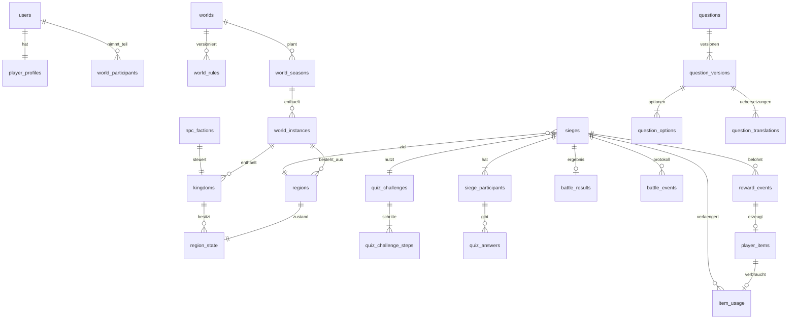

# Datenmodell

Bezug: Brief §12.3–12.4. Konzeptionelles, aber konsistentes relationales Modell für PostgreSQL 16+. SQL-Ausschnitte zeigen die **kritischen** Constraints verbindlich; Spaltenlisten der übrigen Tabellen sind vollständig, Typen dort, wo sie für Korrektheit wichtig sind.

## 1. Grundsätze

- **Instanz-Schlüssel überall:** Jede Spieltabelle trägt `instance_id` (direkt oder über einen eindeutigen Elternteil). Das erzwingt die Welttrennung (Brief §3.4, E2E-12) und erlaubt später Sharding nach Instanz.
- **IDs:** UUIDv7 (in der Anwendung erzeugt, zeitlich sortierbar) für fachliche Entitäten; `bigint identity` für sehr große, rein interne Anhang-Tabellen (Regionen, Historie, Ereignisse, Transaktionen).
- **Zeit:** `timestamptz` (UTC); Fristen werden mit `game_now()` verglichen ([ARCHITECTURE.md §8](ARCHITECTURE.md#8-zeitmodell)).
- **Aktueller Zustand + unveränderliche Protokolle:** Zustandstabellen werden aktualisiert; Protokolltabellen (`*_history`, `*_events`, `*_transactions`, `audit_events`) sind nur anhängbar (UPDATE/DELETE per Rechtevergabe entzogen).
- **Optimistische Version + Zeilensperren:** Zustandszeilen mit Wettbewerb (`region_state`, `sieges`, `kingdoms`) tragen `version`. Kritische Transaktionen sperren mit `SELECT … FOR UPDATE` in fester Reihenfolge ([SIEGE_SYSTEM.md §5](SIEGE_SYSTEM.md#5-nebenläufigkeit-und-sperrreihenfolge)).
- **Enums** als PostgreSQL-`text` mit `CHECK` (leichter erweiterbar als native Enums).

## 2. Zuordnung zum Brief (§12.3)

| Brief | Hier | Bemerkung |
|---|---|---|
| `users`, `player_profiles`, `player_settings`, `player_statistics` | gleichnamig, + `sessions`, `push_subscriptions` | |
| `worlds`, `world_instances`, `world_rules`, `world_seasons`, `world_participants` | gleichnamig, + `season_results` | |
| `regions` | `regions` (statisch) | Koordinaten, Biom, Stufe – ändern sich nie |
| `region_ownership`, `region_protection` | `region_state` | dynamischer Zustand in einer Zeile pro Region: Besitzer, Hauptstadt, Schutz, aktive Belagerung |
| `region_history` | gleichnamig | |
| `kingdoms`, `kingdom_statistics`, `kingdom_history` | gleichnamig | |
| `kingdom_memberships` | **zurückgestellt** | MVP: 1 Spieler = 1 Reich; Tabelle erst mit Allianzen/Co-Regenten (Widerspruch W-15) |
| `npc_factions`, `npc_profiles`, `npc_actions` | gleichnamig | |
| `questions`, `question_versions`, `question_options`, `question_translations`, `question_reviews` | gleichnamig, + `question_stats`, `question_reports`, `player_question_exposure` | |
| `quiz_challenges`, `quiz_answers` | gleichnamig, + `quiz_challenge_steps` | |
| `sieges`, `siege_participants`, `battle_results`, `battle_events` | gleichnamig | **jeder** Kampf (auch PvE) ist eine `siege`-Zeile mit `mode`; PvE wird sofort aufgelöst |
| `item_definitions` | gleichnamig | |
| `player_inventory` | `player_items` | ein Datensatz pro Item-Exemplar (Herkunft und Verbrauch einzeln nachvollziehbar) |
| `inventory_transactions`, `item_usage`, `reward_events` | gleichnamig | |
| `notifications` | gleichnamig | |
| `scheduled_jobs` | Schema `pgboss.*` | von pg-boss verwaltet |
| `audit_events`, `abuse_signals` | gleichnamig | |
| – | `world_events` | Outbox für Echtzeit und Replay |
| – | `game_clock` | Zeitversatz nur für Test/Staging |

## 3. Kern-ER-Diagramm



## 4. Tabellen

### 4.1 Konten und Profile

| Tabelle | Spalten | Constraints / Indizes |
|---|---|---|
| `users` | `id uuid`, `email citext null`, `email_verified_at`, `password_hash text null`, `is_guest bool`, `role text` (`PLAYER`/`EDITOR`/`ADMIN`), `created_at`, `last_seen_at`, `deletion_requested_at`, `deleted_at` | `unique(email) where email is not null`; Gastkonten ohne E-Mail |
| `sessions` | `token_hash bytea PK`, `user_id`, `created_at`, `expires_at`, `last_used_at` | Index `(user_id)`; Token nur gehasht gespeichert |
| `player_profiles` | `user_id PK`, `display_name text` (generiert), `name_seed int`, `cosmetic_avatar text`, `created_at` | `unique(display_name)` |
| `player_settings` | `user_id PK`, `locale text` (`de`/`hu`/`en`), `timezone text`, `auto_extend_enabled bool default false`, `auto_extend_priorities jsonb`, `notification_prefs jsonb` | |
| `player_statistics` | `user_id PK`, Zähler: `battles`, `battles_won`, `defenses`, `defenses_won`, `conquests`, `regions_max`, `defense_points`, `trivia_answered`, `trivia_correct`, `skill_rating numeric`, `skill_rd numeric`, `updated_at` | weltübergreifend (Brief §3.4: globale Profile) |
| `push_subscriptions` | `id`, `user_id`, `endpoint text`, `p256dh text`, `auth text`, `created_at`, `last_success_at`, `failures int` | `unique(endpoint)` |

### 4.2 Welten

| Tabelle | Spalten | Constraints / Indizes |
|---|---|---|
| `worlds` | `id`, `slug`, `mode` (`ETERNAL`/`DAILY`/`WEEKLY`), `name_key`, `status`, `current_rules_id` | `unique(slug)` |
| `world_rules` | `id`, `world_id`, `version int`, `config jsonb` (Schema in `packages/protocol`), `config_hash`, `created_by`, `created_at`, `notes` | `unique(world_id, version)`; Zeilen unveränderlich |
| `world_seasons` | `id`, `world_id`, `period_key` (`2026-11-09`, `2026-W46`), `starts_at`, `ends_at`, `pvp_cutoff_at`, `status` (`SCHEDULED`/`RUNNING`/`CLOSING`/`CLOSED`) | `unique(world_id, period_key)`; `check(starts_at < pvp_cutoff_at and pvp_cutoff_at <= ends_at)` |
| `world_instances` | `id`, `world_id`, `season_id null` (Eternal: null), `rules_id`, `map_seed bigint`, `capacity int`, `status` (`PROVISIONING`/`RUNNING`/`CLOSING`/`CLOSED`/`ARCHIVED`), `starts_at`, `ends_at null`, `closed_at`, `event_seq bigint` (Zähler für `world_events.seq`, [ARCHITECTURE.md §10](ARCHITECTURE.md#10-echtzeit-und-synchronisation)) | Index `(world_id, status)` |
| `world_participants` | `instance_id`, `user_id`, `joined_at`, `status` (`ACTIVE`/`LEFT`/`BANNED`), `current_kingdom_id null`, `last_active_at` | `PK(instance_id, user_id)`; dient auch als Sperrzeile für Inventar-Operationen eines Spielers |
| `season_results` | `instance_id`, `user_id`, `kingdom_id`, `rank int`, `score int`, `details jsonb` | `PK(instance_id, user_id)` |

### 4.3 Karte

```sql
create table regions (
  id            bigint generated always as identity primary key,
  instance_id   uuid not null references world_instances(id),
  q             int  not null,
  r             int  not null,
  chunk_x       int  not null,           -- aus Offset-Koordinaten abgeleitet, unveränderlich
  chunk_y       int  not null,
  biome         smallint not null,
  tier          smallint not null check (tier between 0 and 10),
  strategic_value smallint not null default 0,
  province_id   uuid null,               -- vorbereitet für Provinzen (O-14), im MVP null
  unique (instance_id, q, r)
);
create index regions_chunk on regions (instance_id, chunk_x, chunk_y);

create table region_state (
  region_id        bigint primary key references regions(id),
  instance_id      uuid not null,
  chunk_x          int  not null,        -- Kopie für Chunk-Abfragen ohne Join
  chunk_y          int  not null,
  owner_kingdom_id uuid null references kingdoms(id),   -- null = neutral
  is_capital       bool not null default false,
  owned_since      timestamptz null,
  protected_until  timestamptz null,
  protection_reason text null check (protection_reason in ('CONQUEST','ADMIN')),
  active_siege_id  uuid null,           -- Fremdschlüssel auf sieges(id, target_region_id), siehe §4.7
  version          bigint not null default 0,
  updated_at       timestamptz not null,
  check (not is_capital or owner_kingdom_id is not null)
);
create index region_state_owner on region_state (owner_kingdom_id);
create index region_state_chunk on region_state (instance_id, chunk_x, chunk_y);
create unique index region_state_one_capital on region_state (owner_kingdom_id) where is_capital;
create unique index region_state_active_siege on region_state (active_siege_id) where active_siege_id is not null;
```

| Tabelle | Spalten | Constraints / Indizes |
|---|---|---|
| `region_history` | `id bigint`, `region_id`, `instance_id`, `from_kingdom_id null`, `to_kingdom_id null`, `cause` (`CONQUEST_PVE`/`CONQUEST_PVP`/`TIMEOUT`/`NPC`/`START_CLAIM`/`DECAY`/`ADMIN`), `siege_id null`, `at` | Index `(region_id, at desc)`, `(instance_id, at)` |

### 4.4 Königreiche

| Tabelle | Spalten | Constraints / Indizes |
|---|---|---|
| `kingdoms` | `id`, `instance_id`, `kind` (`PLAYER`/`NPC`), `owner_user_id null`, `npc_faction_id null`, `name_parts jsonb`, `color smallint`, `status` (`ACTIVE`/`FALLEN`/`DISSOLVED`), `region_count int`, `protected_until null`, `protection_reason` (`NEWBIE`/`RESPAWN`/`VACATION`), `generation smallint` (n-tes Reich des Spielers in der Instanz), `founded_at`, `fallen_at`, `version` | `check((kind='PLAYER' and owner_user_id is not null and npc_faction_id is null) or (kind='NPC' and npc_faction_id is not null and owner_user_id is null))`; `unique(instance_id, owner_user_id) where status='ACTIVE' and kind='PLAYER'`; `unique(instance_id, npc_faction_id) where status='ACTIVE' and kind='NPC'` (eine Fraktion = höchstens ein aktives Reich); `check(region_count >= 0)` |
| `kingdom_statistics` | `kingdom_id PK`, `max_regions`, `npc_regions_conquered`, `pvp_won`, `pvp_lost`, `defenses_won`, `defenses_lost`, `defense_points`, `timeout_losses`, `longest_connected`, `updated_at` | |
| `kingdom_history` | `id bigint`, `kingdom_id`, `kind` (`FOUNDED`/`CAPITAL_CHANGED`/`RANK_CHANGED`/`FALLEN`/`RANK_SNAPSHOT`), `payload jsonb`, `at` | Index `(kingdom_id, at)` |

`region_count` ist denormalisiert und wird in derselben Transaktion wie der Besitzwechsel gepflegt (beide Reiche sind ohnehin gesperrt). Der Invariantenjob prüft ihn gegen `count(*)`.

### 4.5 NPCs

| Tabelle | Spalten | Constraints / Indizes |
|---|---|---|
| `npc_profiles` | `id`, `code`, `version`, `skill_theta numeric`, `estimate_spread jsonb` (Parameter von `s(θ)`, [NPC_SYSTEM.md §3.2](NPC_SYSTEM.md#32-schätzung-e)), `rt_log_mu numeric`, `rt_log_sigma numeric`, `created_at` | `unique(code, version)`; unveränderlich |
| `npc_factions` | `id`, `instance_id`, `name_key`, `archetype` (`LIGHT`/`MEDIUM`/`HEAVY`), `profile_id`, `aggression numeric`, `expansion numeric`, `status`, `home_chunk_x`, `home_chunk_y` | |
| `npc_actions` | `id`, `instance_id`, `faction_id`, `tick_id`, `seq smallint`, `kind` (`EXPAND_NEUTRAL`/`ATTACK_NPC`/`ATTACK_PLAYER`/`IDLE`), `target_region_id`, `siege_id null`, `status`, `created_at` | `unique(tick_id, faction_id, seq)` – macht Ticks idempotent |

### 4.6 Quiz

| Tabelle | Spalten | Constraints / Indizes |
|---|---|---|
| `questions` | `id`, `kind` (`TRIVIA`/`ESTIMATE`), `category`, `status` (`DRAFT`/`IN_REVIEW`/`ACTIVE`/`SUSPENDED`/`RETIRED`), `current_version_id null`, `tags text[]` (z. B. `region:HU`), `origin` (`EDITORIAL`/`AI_ASSISTED`/`LICENSED`), `license_note`, `created_by`, `created_at` | Index `(kind, category, status)` |
| `question_versions` | `id`, `question_id`, `version int`, `kind` (Kopie für Checks), `difficulty smallint` (redaktionell 1–5), `calibrated_difficulty numeric null`, `answer_value numeric null`, `answer_precision smallint null`, `answer_unit text null`, `input_min numeric null`, `input_max numeric null`, `estimate_scale_type text null` (`LINEAR`/`LOG`), `estimate_scale numeric null`, `sources jsonb`, `status` (`DRAFT`/`IN_REVIEW`/`APPROVED`/`RETIRED`), `approved_by`, `approved_at`, `content_hash` | `unique(question_id, version)`; `check((kind='TRIVIA' and answer_value is null) or (kind='ESTIMATE' and answer_value is not null and answer_precision is not null))`; Trigger: Version ab `APPROVED` unveränderlich |
| `question_options` | `version_id`, `option_key text`, `is_correct bool` | `PK(version_id, option_key)`; `unique(version_id) where is_correct` (höchstens eine richtige; „genau eine“ und „≥ 4 Optionen“ prüft die Freigabe) |
| `question_translations` | `version_id`, `locale`, `prompt text`, `option_texts jsonb` (`option_key → Text`), `unit_label text null`, `explanation text null`, `status` (`DRAFT`/`REVIEWED`/`APPROVED`), `translated_by`, `reviewed_by`, `reviewed_at` | `PK(version_id, locale)` |
| `question_reviews` | `id`, `version_id`, `locale null` (null = fachliche Prüfung), `reviewer_id`, `verdict` (`APPROVE`/`REJECT`/`CHANGES_REQUESTED`), `notes`, `created_at` | |
| `question_stats` | `version_id`, `locale`, `shown`, `correct`, `exact_hits`, `sum_time_ms`, `updated_at` | `PK(version_id, locale)` – Grundlage für Kalibrierung und Sprach-Fairness-Monitoring |
| `question_reports` | `id`, `version_id`, `locale`, `reporter_user_id`, `reason` (Auswahlliste), `note text null` (nur Redaktion sichtbar), `status`, `created_at` | |
| `player_question_exposure` | `user_id`, `question_id`, `last_seen_at`, `times int` | `PK(user_id, question_id)` |
| `quiz_challenges` | `id`, `siege_id`, `created_at`, `target_difficulty numeric`, `rng_key_id`, `rng_version` | `unique(siege_id)` |
| `quiz_challenge_steps` | `challenge_id`, `step_index smallint`, `kind`, `version_id`, `time_limit_ms int` | `PK(challenge_id, step_index)`; Version ist fix, solange die Herausforderung läuft (Brief §5.4) |

```sql
create table quiz_answers (
  id                uuid primary key,
  challenge_id      uuid not null references quiz_challenges(id),
  participant_id    uuid not null references siege_participants(id),
  step_index        smallint not null,
  locale            text not null,
  presentation      jsonb not null,      -- nur serverseitig: Optionstoken → option_key, Reihenfolge
  presented_at      timestamptz not null,
  answer_deadline_at timestamptz not null, -- presented_at + time_limit + cap (QUIZ_ENGINE §7.1); rechtzeitig: received_at < answer_deadline_at
  received_at       timestamptz null,     -- beim Eintreffen der Anfrage, vor dem Warten auf Sperren (SIEGE_SYSTEM §6.1)
  answer_option_key text null,
  answer_value      numeric null,         -- normalisiert auf answer_precision
  raw_input         text null,            -- Originaleingabe für Audit (Zahlenformat)
  client_elapsed_ms int null,
  rtt_ms            int null,
  server_elapsed_ms int null,
  effective_ms      int null,
  is_correct        bool null,
  distance          numeric null,
  status            text not null check (status in ('PRESENTED','ANSWERED','TIMED_OUT','GENERATED')),
  idempotency_key   uuid null,
  unique (participant_id, step_index)
);
-- Trigger: Zeilen mit status <> 'PRESENTED' sind unveränderlich ("Antworten werden nach Einreichung gesperrt").
```

`status = 'GENERATED'` kennzeichnet NPC-Antworten; sie entstehen beim Anlegen der Herausforderung, also bevor der Mensch antwortet.

### 4.7 Kämpfe und Belagerungen

```sql
create table sieges (
  id                  uuid primary key,
  instance_id         uuid not null references world_instances(id),
  mode                text not null check (mode in ('PVE','PVP')),   -- Auswertungsart: PVE sofort, PVP mit Frist
  target_region_id    bigint not null references regions(id),
  attacker_kingdom_id uuid not null references kingdoms(id),
  defender_kingdom_id uuid null references kingdoms(id),     -- null = neutral
  defender_kind       text not null check (defender_kind in ('PLAYER','NPC','NEUTRAL')),
  status              text not null check (status in ('PREPARING','ATTACK_FAILED','AWAITING_DEFENSE','DEFENDING','RESOLVING',
                        'ATTACKER_WON','DEFENDER_WON','ATTACKER_WON_BY_TIMEOUT','CANCELLED','EXPIRED_INVALID')), -- SIEGE_SYSTEM §3
  created_at          timestamptz not null,
  attack_presented_at timestamptz null,  -- Budgetverbrauch ab hier
  opened_at           timestamptz null,  -- Beginn der Verteidigungsfrist
  base_deadline_at    timestamptz null,
  deadline_at         timestamptz null,
  max_deadline_at     timestamptz null,
  defense_started_at  timestamptz null,
  resolved_at         timestamptz null,
  outcome             text null,
  outcome_reason      text null,
  rules_snapshot      jsonb not null,    -- Fristen/Limits zum Zeitpunkt der Eröffnung
  version             int not null default 0,
  idempotency_key     uuid not null unique,
  unique (id, target_region_id),         -- Ziel des Fremdschlüssels aus region_state
  -- Fristen: entweder alle drei leer (PvE, PREPARING) oder alle gesetzt und geordnet (I10)
  check ((base_deadline_at is null and deadline_at is null and max_deadline_at is null)
      or (base_deadline_at is not null and deadline_at is not null and max_deadline_at is not null
          and base_deadline_at <= deadline_at and deadline_at <= max_deadline_at)),
  -- nur gültige Kombinationen: sofortige Auswertung gegen NPC/neutral, Frist nur gegen Spielerreiche
  check ((mode = 'PVE' and defender_kind in ('NPC','NEUTRAL')) or (mode = 'PVP' and defender_kind = 'PLAYER')),
  check ((defender_kind = 'NEUTRAL') = (defender_kingdom_id is null))
);
-- Zeiger der Region auf ihre aktive Belagerung: muss existieren und genau diese Region betreffen
alter table region_state add constraint region_state_active_siege_fk
  foreign key (active_siege_id, region_id) references sieges (id, target_region_id);
-- Höchstens eine aktive Belagerung pro Region – von der Datenbank erzwungen:
create unique index sieges_one_active_per_region on sieges (target_region_id)
  where status in ('PREPARING','AWAITING_DEFENSE','DEFENDING','RESOLVING');
create index sieges_open_by_defender on sieges (defender_kingdom_id)
  where status in ('PREPARING','AWAITING_DEFENSE','DEFENDING');
create index sieges_by_attacker_time on sieges (attacker_kingdom_id, attack_presented_at);
create index sieges_due on sieges (deadline_at) where status in ('AWAITING_DEFENSE','DEFENDING');
```

`mode` beschreibt die Auswertungsart, nicht die Art des Angreifers: NPC-Angriffe auf Spieler (Phase 5, [NPC_SYSTEM.md §5.2](NPC_SYSTEM.md#52-aktionen)) sind Belagerungen mit Frist und werden als `PVP` gespeichert; der Angreifer ist dann ein Reich mit `kingdoms.kind = 'NPC'`.

| Tabelle | Spalten | Constraints / Indizes |
|---|---|---|
| `siege_participants` | `id`, `siege_id`, `role` (`ATTACKER`/`DEFENDER`), `kingdom_id null`, `user_id null`, `npc_profile_id null`, `locale null` | `unique(siege_id, role)` |
| `battle_results` | `siege_id PK`, `winner_role`, `reason` (`TIMEOUT`/`ATTACKER_GATE`/`TRIVIA`/`ESTIMATE`/`SPEED`/`FULL_TIE`/`CANCELLED`), `attacker_summary jsonb`, `defender_summary jsonb`, `defended bool`, `defense_points smallint not null default 0` (vergebene Verteidigungspunkte, [GAME_RULES.md §5.5](GAME_RULES.md#55-verteidigungspunkte-v-grundsatz-e-werte-o-18)), `decided_at`, `core_version text` | PK verhindert ein zweites Ergebnis; dass jede beendete Belagerung **eines** hat, sichern das Einfügen in derselben Transaktion wie der Endübergang und der Invariantenjob (I6) |
| `battle_events` | `id bigint`, `siege_id`, `seq int`, `type`, `payload jsonb`, `at` | `unique(siege_id, seq)`; nur anhängen |

### 4.8 Items und Belohnungen

| Tabelle | Spalten | Constraints / Indizes |
|---|---|---|
| `item_definitions` | `id text PK` (`hourglass_small`, `chronos_seal`, `time_crystal`), `kind` (`DEFENSE_EXTENSION`), `rarity`, `effect jsonb` (`{"hours":6}`), `name_key`, `allowed_modes text[]`, `enabled bool` | Referenzdaten per Migration |
| `reward_events` | `id`, `instance_id`, `user_id`, `source_type` (`SIEGE`), `source_id`, `eligibility jsonb` (geprüfte Regeln, Gründe), `rng_draw numeric`, `result_item_def_id null`, `outcome` (`NONE`/`GRANTED`/`PENDING`/`NOT_GRANTED_FULL`/`NOT_ELIGIBLE`), `at` | `unique(source_type, source_id, user_id)` – **keine doppelte Belohnung** (E2E-11) |
| `player_items` | `id`, `instance_id`, `user_id`, `item_def_id`, `status` (`PENDING`/`AVAILABLE`/`CONSUMED`/`EXPIRED`/`DISCARDED`), `reward_event_id`, `acquired_at`, `pending_expires_at null`, `consumed_at null` | Index `(instance_id, user_id, status)`; `unique(reward_event_id)` |
| `item_usage` | `id`, `item_id`, `siege_id`, `user_id`, `auto bool`, `old_deadline_at`, `new_deadline_at`, `effect_hours`, `applied_minutes`, `idempotency_key`, `at` | `unique(item_id)` – ein Item höchstens einmal; `unique(idempotency_key)` |
| `inventory_transactions` | `id bigint`, `instance_id`, `user_id`, `item_id`, `type` (`GRANTED`/`PENDING_CREATED`/`CLAIMED`/`CONSUMED`/`EXPIRED`/`DISCARDED`/`ADMIN_ADJUST`), `ref_type`, `ref_id`, `at` | nur anhängen; Index `(user_id, at)` |

### 4.9 Betrieb

| Tabelle | Spalten | Constraints / Indizes |
|---|---|---|
| `notifications` | `id`, `user_id`, `instance_id null`, `type`, `payload jsonb`, `created_at`, `read_at null`, `push_sent_at null` | Index `(user_id, created_at desc) where read_at is null` |
| `world_events` | `id bigint identity PK`, `instance_id`, `seq bigint` (lückenlos je Instanz aus `world_instances.event_seq`), `chunk_x null`, `chunk_y null`, `user_id null`, `type`, `payload jsonb`, `created_at` | `unique(instance_id, seq)`; Aufbewahrung 7 Tage |
| `idempotency_keys` | `scope text` (Konto-ID bzw. vor der Anmeldung Hash des Schlüssels), `key uuid`, `endpoint`, `request_hash`, `response_status`, `response_body jsonb`, `created_at` | `PK(scope, key)`; Aufbewahrung 24 h ([API.md §1](API.md#1-konventionen)) |
| `audit_events` | `id bigint`, `actor_user_id null`, `actor_role`, `action`, `target_type`, `target_id`, `before jsonb`, `after jsonb`, `reason text`, `at` | nur anhängen |
| `abuse_signals` | `id`, `user_id`, `instance_id null`, `kind`, `score numeric`, `details jsonb`, `status` (`OPEN`/`REVIEWED`/`DISMISSED`/`ACTIONED`), `created_at` | Index `(status, created_at)` |
| `game_clock` | `id int PK check (id=1)`, `offset interval` | in Produktion per Migration auf 0 und schreibgeschützt |

## 5. Invarianten

| # | Invariante | Durchsetzung |
|---|---|---|
| I1 | Eine Region hat höchstens einen Besitzer | Struktur (eine Spalte) |
| I2 | Höchstens eine aktive Belagerung pro Region | partieller Unique-Index `sieges_one_active_per_region` |
| I3 | `region_state.active_siege_id` zeigt auf eine aktive Belagerung genau dieser Region, und jede aktive Belagerung ist so eingetragen | Fremdschlüssel `(active_siege_id, region_id)` (Existenz, richtige Region) + Transaktion ([SIEGE_SYSTEM.md §3.1](SIEGE_SYSTEM.md#31-regionsreservierung-e)) + Invariantenjob (Status) |
| I4 | `kingdoms.region_count` = Anzahl besessener Regionen | Transaktion + Invariantenjob |
| I5 | Jedes aktive Reich mit Regionen hat genau eine Hauptstadt | Unique-Index (≤ 1) + Transaktion + Job (≥ 1) |
| I6 | Jede aufgelöste Belagerung hat genau ein Ergebnis | höchstens eines: PK `battle_results(siege_id)`; mindestens eines: Einfügen in der Transaktion des Endübergangs + Invariantenjob |
| I7 | Pro Kampf und Spieler höchstens eine Belohnung | Unique `reward_events` |
| I8 | Jedes Item wird höchstens einmal verbraucht | Unique `item_usage(item_id)` + Statusvergleich |
| I9 | Verfügbare Items pro Spieler ≤ Inventargrenze | Transaktion unter Sperre `world_participants` + Job |
| I10 | Fristen alle leer oder alle gesetzt mit `base_deadline ≤ deadline ≤ max_deadline` | `CHECK` |
| I11 | Abgegebene Antworten sind unveränderlich | Trigger |
| I12 | Freigegebene Fragenversionen sind unveränderlich | Trigger |
| I13 | Alle Fremdschlüssel einer Spielzeile gehören zur selben Instanz | Anwendungslogik + Invariantenjob (zusammengesetzte FKs wären möglich, erschweren aber Migrationen – Entscheidung in Phase 1 nach Messung) |

## 6. Migrationsstrategie

1. **Nur vorwärts:** nummerierte SQL-Dateien `NNNN_beschreibung.sql`; eine angewandte Migration wird nie geändert.
2. **CI:** Jede Pipeline wendet alle Migrationen auf eine leere Datenbank an, führt Tests aus und vergleicht das Schema mit dem eingecheckten Typ-Stand (Drift-Erkennung).
3. **Expand/Contract** für Änderungen an genutzten Spalten: neue Struktur hinzufügen → doppelt schreiben → umstellen → alte Struktur in späterer Migration entfernen. Ermöglicht Deployments ohne Ausfall.
4. **Referenzdaten** (Itemdefinitionen, Basis-NPC-Profile) per Migration; **Testdaten/Seeds** getrennt und nie in Produktion.
5. **Produktion:** Jede Produktionsmigration benötigt Freigabe, ein aktuelles Backup und einen vorherigen Lauf gegen eine Kopie (Brief §20). Destruktive Schritte (DROP, Datenlöschung) sind eigene Migrationen mit eigener Freigabe.
6. **Partitionierung** großer Protokolltabellen (`battle_events`, `world_events`, `region_history`, `inventory_transactions`, `audit_events`) nach Monat, sobald Volumen es rechtfertigt – nicht im MVP.

## 7. Aufbewahrung ([E], Teil der Datenschutzprüfung)

| Daten | Aufbewahrung |
|---|---|
| `world_events` | 7 Tage |
| `battle_events`, `quiz_answers` Eternal | 12 Monate, danach Zusammenfassung in `battle_results` |
| Daily/Weekly-Instanzen | 30 Tage nach Saisonende vollständig, danach nur `season_results` und `battle_results` |
| `audit_events` | 24 Monate |
| Sitzungen | bis Ablauf + 30 Tage |
| IP-Adressen | nicht in der Datenbank; in Logs max. 7 Tage (Missbrauchsabwehr) |
| `idempotency_keys` | 24 Stunden |
| Gelöschte Konten | Löschkaskade und Anonymisierung innerhalb von 24 h nach [SECURITY.md §5.2](SECURITY.md#52-umsetzung); Reiche erhalten einen anonymen Namen, damit die Spielhistorie anderer konsistent bleibt |
