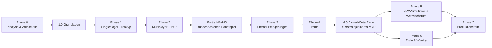

# Entwicklungsplan

Bezug: Brief §16 (Phasen), §20 (Arbeitsweise). Die Phasen des Briefs bleiben erhalten; ergänzt werden ein Grundlagenschritt vor Phase 1 und ein **Closed-Beta-Schritt nach Phase 4**, damit echte Spieler den Kern-Loop testen, bevor NPC-Simulation und Saisonmodi gebaut werden.

**Kurswechsel 2026-11-10 (ADR-046):** Nach Phase 2 Paket 2 kommt zuerst die rundenbasierte **Partie** (Pakete M1–M5, [MATCH_RULES.md](MATCH_RULES.md)); die Eternal-Welt ruht mit Phase 2 Paket 3 und 4, bis die Partie fertig ist.

## 1. Überblick

Jede Implementierungsphase besteht aus mehreren kleinen Pull Requests. Jeder Implementierungs-PR enthält Code, Tests, aktualisierte Dokumentation und einen Bericht nach Brief §20 „Berichterstattung“; reine Dokumentations-PRs (wie Phase 0) enthalten Dokumente, Link- und Diagrammprüfung und den Bericht.

**Definition of Done (für jeden Implementierungs-PR):** Typprüfung und Lint grün · Tests für jede neue Regel und jeden Zustandsübergang · Migration (falls Schema) mit Test auf leerer DB · betroffene Dokumente aktualisiert · neue Annahmen in [GAME_RULES.md](GAME_RULES.md) bzw. [DECISIONS.md](DECISIONS.md) eingetragen · keine Secrets · keine Änderung an Produktivsystemen.

## 2. Phasen im Detail

### Phase 0 – Analyse und Architektur ✅

Lieferung: dieses Dokumentationspaket. Keine produktiven Änderungen.

### Schritt 1.0 – Grundlagen ✅ (risikoarm, unabhängig von offenen Produktentscheidungen)

| Paket | Inhalt |
|---|---|
| Monorepo | pnpm Workspaces, TypeScript strict, ESLint/Prettier, Abhängigkeitsregeln zwischen Paketen |
| CI | GitHub Actions: Install, Lint, Typecheck, Unit, Integration mit Postgres-Service-Container |
| `protocol` | zod-Schema der Regelkonfiguration mit Standardwerten aus [GAME_RULES.md §10](GAME_RULES.md#10-parametertabelle); Zahlparser (Deutsch, ADR-023) |
| `game-core` | Hex-Mathematik und Chunks, Rang-Funktion, `resolveDuel` mit verdecktem Gate ([O-01] entschieden), effektive Zeit, Fristberechnung, Drop-Ziehung, RNG (HMAC + sfc32), NPC-Antwortmodell |
| `db` | Migrationsläufer, erste Migrationen (Konten, Welten, Regionen, Reiche), `game_now()`, Testhelfer |
| Lokal | `docker-compose.yml` für Postgres, `.env.example` |
| Inhalte | YAML-Schema für Fragen, Validierungswerkzeug, 40 Fixture-Fragen (Deutsch) |

Abnahme: CI grün; Unit-Tests nach [TEST_PLAN.md §3](TEST_PLAN.md#3-unit-tests-brief-171) für alle Kernfunktionen.

Umgesetzt am 2026-11-09 (Stand der Tests: [TEST_PLAN.md §7](TEST_PLAN.md#7-aktueller-stand)). Verschoben nach Phase 1, weil erst dort Abfragen entstehen: Kysely mit generierten Tabellentypen und die Drift-Prüfung „Schema gegen eingecheckten Typ-Stand“ aus [DATA_MODEL.md §6](DATA_MODEL.md#6-migrationsstrategie); ebenso die Basis-NPC-Profile als Referenzdaten (umgesetzt mit Phase 1, Paket 1, Migration 0007; genutzt ab dem PvE-Ablauf in Paket 3).

### Phase 1 – Singleplayer-Gameplay-Prototyp

| Paket | Inhalt |
|---|---|
| Karte | Generator (Chunks, Biome, Stufen, NPC-Fraktionen), Testwelt ≈ 150 Regionen |
| Konto | Gastkonto mit Sitzung (dauerhaft, damit „nach erneutem Login“ funktioniert) |
| Einstieg | Beitritt, Startregion, Hauptstadt, Tutorial-Garnison |
| Kampf PvE | Angriffsberechtigung, Herausforderungsprotokoll (present/answer, Zeitlimits, Reload), versiegelte NPC-Antworten, Auflösung, Besitzwechsel, Schutzzeit, Historie |
| Client | PixiJS-Karte mit Chunk-Laden, Regionsdetails, Quiz-Vollbild, Reichsanzeige mit Rang, Oberfläche auf Deutsch (Texte trotzdem über i18n-Schlüssel, ADR-023) |
| Inhalte | 100 Trivia + 50 Schätzfragen, geprüft, auf Deutsch; bis zur Entscheidung über [O-02] mit den 40 Testfragen (PO 2026-11-09) |

Abnahme (Brief): Ein Spieler erobert wiederholt NPC-Gebiete, erweitert sein Reich und sieht nach erneutem Login den korrekten Weltzustand. Tests: E2E-01, Integration „Gebietseroberung PvE“.

Umsetzung in vier aufeinander folgenden Pull Requests:

1. Tabellen für Fragen und Kämpfe, Betrieb und NPC-Profile (Migrationen 0005–0007), typisierter Datenbankzugriff mit Drift-Prüfung, Fragenimport – umgesetzt am 2026-11-10
2. Kartengenerator, Testwelt, Server-Grundgerüst, Gastkonto mit Sitzung, Beitritt mit Startregion und Hauptstadt, Kartenabfragen – umgesetzt am 2026-11-10
3. PvE-Kampf: Berechtigung, Herausforderung (present/answer), versiegelte NPC-Antworten, Auflösung, Besitzwechsel, Schutzzeit, Historie, Outbox; Integration „Gebietseroberung PvE“ – umgesetzt am 2026-11-10 (Item-Drops folgen mit Phase 4, dynamische NPC-Stärke und Spielstärkewert mit der Kalibrierung)
4. Client (PixiJS-Karte, Regionsdetails, Quiz, Reichsanzeige) und E2E-01 – umgesetzt am 2026-11-10 (ohne WebSocket, ADR-036)

### Phase 2 – Echter Multiplayer

| Paket | Inhalt |
|---|---|
| Konto | Registrierung/Anmeldung nach [O-03], generierte öffentliche Namen ([O-10]) |
| PvP | Belagerungen mit verdecktem Gate, Verteidigung, Verteidigungspunkte ([O-18]), Schätzfrage immer gestellt, zählt nur bei Gleichstand ([O-19]), Hauptstadt-Leben für Spielerreiche mit voller Frist und Sperre je Angreifer (`capital.hitCooldownPerAttacker`, [O-20]), Fristen (in Tests kurz konfiguriert), Auflösungstransaktion, Lazy Resolution |
| Echtzeit | WebSocket-Gateway, Outbox, Chunk-Abos, `resume`/Snapshot |
| Nebenläufigkeit | Harness und Tests N1–N4, N8, N12 |
| Staging | erste erreichbare Testumgebung, falls [O-11] freigegeben; sonst Test im lokalen Netz |

Abnahme (Brief): Zwei echte Spieler kämpfen auf derselben Karte ohne inkonsistente Besitzverhältnisse. Tests: E2E-02, -03, -04, -09 (E2E-10 ruht bis zu einer zweiten Sprache, ADR-023).

Umsetzung in vier Pull Requests, je Paket einer, in der Reihenfolge PvP, Konto, Echtzeit, Nebenläufigkeit:

1. PvP: Eröffnung nach dem Angreifer, Verteidigung mit Frage im Verteidigungsbeginn, Auflösung (Verteidigung, Fristablauf, Abbruch), Verteidigungspunkte mit Paarsperre, PvP-Grenzen und Hauptstadtsperre, Belagerungsübersicht, Neugründung nach dem Fall, Spieltest-Regeln (`pnpm world:create --rules=playtest`, 10 min Frist); E2E-02 und -03 – umgesetzt am 2026-11-10 (ADR-038 bis ADR-042; ohne Echtzeit, Push und Verlängerung)
2. Konto nach [O-03] und [O-10]: Gast sichern mit privatem Benutzernamen, Passwort (Argon2id) und Spielernamen aus Vorschlägen, Anmelden mit Sitzungsrotation und Anmeldebremse, Spielername und Passwort ändern, Reichsname aus Vorschlägen bei Beitritt und Neugründung, Kontoseite und Weltwahl im Client, Passwort-Reset per Befehl, Löschung inaktiver Gäste nach 90 Tagen mit Anonymisierung – umgesetzt am 2026-11-10 (ADR-043 bis ADR-045; E-Mail-Feld aufgeschoben bis zum Mailversand)
3. Echtzeit (WebSocket) – ruht (ADR-046); der WebSocket entsteht zuerst als Partie-Paket M3 und wird mit der Eternal-Fortsetzung für die Karte erweitert
4. Nebenläufigkeit (Harness, N1–N4, N8, N12, E2E-09) und E2E-04 – ruht bis zur Eternal-Fortsetzung (ADR-046)

### Partie – rundenbasiertes Hauptspiel (ADR-046)

Zwei oder drei Spieler auf einer festen Karte je Spielerzahl (Wendelmark zu dritt, Kernmark zu zweit), freie Plätze auf Wunsch mit Bots (seit 2026-11-11, ADR-052; davor Bots nur in Testpartien, ADR-048), gleichzeitige Fragen mit Timern, höchstens etwa 18 Minuten je Partie; Regeln in [MATCH_RULES.md](MATCH_RULES.md). Fünf Pull Requests in dieser Reihenfolge, jeder erst nach dem „merge“ des Product Owners im Hauptzweig; spielbar wird die Partie mit M4.

| Paket | Inhalt | Abnahme |
|---|---|---|
| M1 Regeln | Zustandsmaschine in `game-core` (Karte, Hauptstadtwahl, Landnahme, Duell, Hauptstadtleben, Wertung) für zwei oder drei Spieler, Bots für Testpartien, Regelkonfiguration, Doku – umgesetzt am 2026-11-10 (ADR-047, ADR-048) | Unit-Tests je Regel; Simulation von je 1 000 Partien zu dritt und zu zweit ohne Verstoß |
| M2 Server | Migration für Partien, Plätze, Fragen und Antworten; Ablaufsteuerung mit Timern und Wiederanlauf nach Neustart; Endpunkte für Anlegen mit Einladungscode, Beitritt, Start mit zwei oder drei Spielern, Wahl, Antwort und Zustand; Testpartie mit Bots (nicht in Produktion) – umgesetzt am 2026-11-10 (ADR-049) | Integrationstest einer ganzen Partie mit kurzen Zeiten; Neustart mitten in einer Frage |
| M3 Echtzeit | WebSocket mit Sitzungsprüfung, ein Kanal je Partie, vollständiger Zustand beim Wiederverbinden, Herzschlag | drei Testclients sehen jede Frage gleichzeitig; Wiederverbinden mitten in einer Frage |
| M4 Browser | Startseite „Partie spielen“, Aufstellung, Karte, Frage mit Countdown, Wahl, Duell zuschauen, Ergebnis – umgesetzt am 2026-11-10 mit Abfrage statt WebSocket (ADR-050), vor M3 | E2E: ganze Testpartie gegen zwei Bots, normale Partie mit zwei Browsern; Spieltest beim Product Owner (allein gegen Bots oder mit Mitspielern) |
| M5 Fragen | mehr Fragen nach Entscheidung E2, keine Wiederholung über mehrere Partien je Spieler | Inhaltsprüfung grün; in den ersten 5 Partien eines Spielers wiederholt sich keine Frage |
| A1 Ausbau: Regeln | Partie mit Burgen, Dörfern, Armeen, Brot und Baustoff und Glücksrad als eigene Zustandsmaschine in `game-core`, Bots, Regelwerte, Doku – umgesetzt am 2026-11-11 (ADR-057, [MATCH_RULES.md §11](MATCH_RULES.md#11-ausbau-burgen-dörfer-armeen)) | Unit-Tests je Regel; Simulation von je 1 000 Partien zu dritt und zu zweit mit Invarianten, Obergrenzen und Bändern der Spielbalance |
| A2 Ausbau: Server | Startfrage, Burgen, Dörfer, Rüstzeit, Aufdecken und Glücksrad in der Ablaufsteuerung, Lieblingskategorien in der Aufstellung, Migration; laufende Partien der bisherigen Art spielen zu Ende | Integrationstest: ganze Partie mit Ausbau gegen Bots, Rüstzeit nach Ablauf, Wiederanlauf |
| A3 Ausbau: Browser | Bildentwürfe zur Freigabe, dann Rüstzeit mit Werkzeugen, Gebäude und Armeen auf der Karte, Glücksrad in der Ansage; nach dem Strang „Partie am Handy ruhiger machen“ | E2E: ganze Partie mit Ausbau; Prüfung am iPhone |
| A4 Ausbau: Spieltest | mit dem Product Owner am Handy, danach Zahlen und Zeiten nachziehen | Rückmeldung des Product Owners |

Danach geht es mit der Eternal-Welt weiter (Phase 2 Paket 3 und 4, dann Phase 3).

### Phase 3 – Eternal-Belagerungen

| Paket | Inhalt |
|---|---|
| Fristen | 24 h, Startsperre, pg-boss-Timeout-Jobs, Sweeper, Neustartfestigkeit |
| Limits und Schutz | Angriffs- und Versuchskontingente, offene Belagerungen je Reich, Schutz nach Eroberung, Anfänger-, Wiederaufbau-, Rangabstandsschutz |
| Reich | Hauptstadt-Leben und Übernahme (für NPC-Reiche seit 2026-11-10, ADR-037), Totalverlust, Neustart |
| UI | Belagerungs-Dashboard, Mitteilungen in der App |
| Benachrichtigung | Web Push (nach [O-04]), Erinnerungen 6 h / 1 h |

Abnahme (Brief): Eine nicht beantwortete Belagerung wird zuverlässig beendet und das Gebiet korrekt übertragen, auch ohne Online-Spieler und bei Server-Neustart während der Frist. Tests: E2E-05, -08.

### Phase 4 – Items

| Paket | Inhalt |
|---|---|
| 4a | Itemdefinitionen, qualifizierte Eroberung (Q1–Q7), Drops, Inventar + Ablage, manuelle Verlängerung mit Vorschau, Transaktionshistorie, Simulation `tools/sim/items` |
| 4b | automatische Verwendung (standardmäßig aus) – **nach der Closed Beta**, nicht Teil des MVP ([MVP.md](MVP.md)); Abnahme dann mit eigenem Integrationstest (höchstens eine Auto-Verlängerung je Belagerung und Auslösefenster, nie Quizantworten) |

Abnahme (Brief, Paket 4a): Ein erspieltes Zeit-Item kann genau einmal zur gültigen Verlängerung einer offenen Belagerung eingesetzt werden. Tests: E2E-06, -07, -11, Integration N5–N7.

### Schritt 4.5 – Closed-Beta-Reife (= erstes spielbares MVP, siehe [MVP.md](MVP.md))

Vorgezogene Teile aus Phase 7, damit eine kleine, eingeladene Gruppe spielen kann: Hosting ([O-11]), Backups und Wiederherstellungstest, Monitoring und Alarme, minimale Admin-Werkzeuge, Datenschutzerklärung/Impressum-Entwurf, Kontolöschung und Export, ≈ 650 geprüfte Fragen, Fehlermeldefunktion für Fragen, Feedbackkanal.

### Phase 5 – Erweiterte NPC-Simulation und Weltwachstum

NPC-Ticks, Expansion, NPC-Angriffe auf Spieler mit Kontingent ([O-13]), dynamische Schwierigkeit, Aktivitätsgrenzen, Admin-Notschalter, Chunk-Ring-Freischaltung der Eternal-Welt, Inaktivitätsstufen ([O-15]).
Abnahme (Brief): Die Welt entwickelt sich nachvollziehbar weiter, auch wenn keine menschlichen Spieler aktiv sind (Simulationstest über 30 simulierte Tage mit Invariantenprüfung).

### Phase 6 – Daily und Weekly

Saisonplanung, Instanzzuteilung, symmetrische Startpositionen, kurze Fristen, Angriffsschluss, Wertung, `season_results`, Archivierung.
Abnahme (Brief): Daily, Weekly und Eternal laufen parallel ohne gegenseitige Beeinflussung. Test: E2E-12.

### Phase 7 – Produktionsreife

Lasttests gegen die Hypothesen in [WORLD_SYSTEM.md §4.3](WORLD_SYSTEM.md#43-kapazitätsabschätzung-hypothese-durch-lasttests-zu-bestätigen), Security-Audit und Penetrationstest, Anti-Cheat-Tests, Usability- und Barrierefreiheitstests, mobile Optimierung, Fragenqualität, Datenschutz- und Lizenzprüfung, Markenprüfung ([O-12]), Recovery-Übung, Staging-Abnahme, kontrollierte öffentliche Beta.

## 3. Was vor welcher Phase entschieden sein muss

| Vor | Entscheidungen |
|---|---|
| Schritt 1.0 | keine ([O-01] ist entschieden) |
| Phase 1 | ~~[O-02] Fragenbeschaffung~~ vertagt (PO 2026-11-09): Phase 1 mit den 40 Testfragen, Klärung vor der Beta |
| Phase 2 | ~~[O-03] Kontomodell~~ und ~~[O-10] Namen~~ entschieden, [O-11] Staging-Hosting vertagt (Test lokal oder im Heimnetz), ~~[O-19] Schätzfrage als Tiebreaker im PvP~~ und ~~[O-20] Übernahme von Spielerreichen~~ entschieden (alle PO 2026-11-10); [O-18] Verteidigungspunkte mit der Empfehlung als Standardannahme umgesetzt, Werte und Nutzen offen |
| Partie | E2 Fragenquelle (vor M5), E3 Standardwerte (nach dem ersten Spieltest nachjustieren), siehe [MATCH_RULES.md §10](MATCH_RULES.md#10-offen) |
| Phase 3 | [O-04] Benachrichtigungen, [O-05] Belagerungskapazität, [O-07] Schutzregeln, [O-08] PvE-Tempo |
| Phase 4 | [O-09] Drops bei Timeout-Siegen |
| Closed Beta | [O-11] Hosting, [O-12] Name |
| Nach Closed Beta | [O-06] Urlaubsmodus (mit Beta-Daten zu Timeout-Verlusten) |
| Phase 5/6 | [O-13], [O-14], [O-15], [O-16] |
| Nach Phase 6 | [O-17] Live-Duelle |
