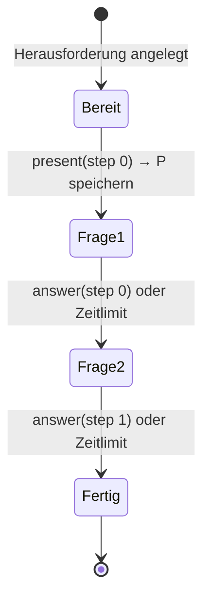
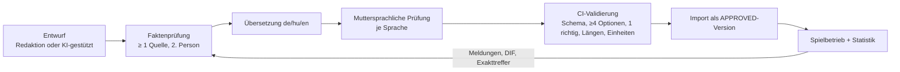

# Quiz-Engine

Bezug: Brief §5, §10.3, §11.5, §13.1. Kennzeichnung siehe [README](README.md#kennzeichnung-von-regeln).

## 1. Ziele

1. **Gleiche Aufgabe für beide Seiten:** dieselbe unveränderliche Fragenversion, unabhängig von Sprache und Zeitpunkt [V].
2. **Spoilerfrei asynchron:** Keine Information über Lösung oder Gegnerleistung vor der Auflösung [V].
3. **Server-Autorität:** Richtigkeit, Abstand, Zeit und Ergebnis bestimmt ausschließlich der Server [V].
4. **Reload-sicher:** Ein Reload verliert die Aufgabe nicht und schafft keine neue Chance [V-nah, Brief §11.5].
5. **Reproduzierbar:** Jede Auswertung lässt sich aus gespeicherten Daten nachrechnen (Brief §18).

## 2. Trivia-Fragen (Multiple Choice)

| Feld | Inhalt | Kennz. |
|---|---|---|
| Frage-ID, Versionsnummer | `questions.id`, `question_versions.version`; freigegebene Versionen sind unveränderlich | [V] |
| Kategorie | eine der elf Kategorien aus Brief §5.6 | [A] |
| Schwierigkeit | redaktionell 1–5; später zusätzlich kalibriert aus Spieldaten (§10) | [A/E] |
| Optionen | mindestens 4; jede Option hat einen sprachunabhängigen Schlüssel `option_key`; genau eine ist richtig | [V] |
| Texte | je Sprache Fragetext und Optionstexte (`option_key → Text`) | [V] |
| Quellen | mindestens eine überprüfbare Quelle pro Frage | [V-nah] |
| Status | `DRAFT → IN_REVIEW → APPROVED → RETIRED` pro Version; zusätzlich `SUSPENDED` auf Fragenebene | [V-nah] |
| Herkunft | `EDITORIAL`, `AI_ASSISTED` (nur nach menschlicher Prüfung aktivierbar), `LICENSED` (mit Lizenzvermerk) | [V-nah, Brief §5.6] |
| Tags | z. B. `region:HU` für landesspezifisches Wissen (§4) | [E] |

**Reihenfolge der Optionen:** pro Teilnehmer zufällig gemischt. An den Client gehen nicht die `option_key`s, sondern pro Präsentation neue Zufallstoken (`presentation` in `quiz_answers`, nur serverseitig gespeichert). So lässt sich aus wiederholten Fragen keine Zuordnung „Schlüssel → richtige Antwort“ lernen [E].

## 3. Schätzfragen

| Feld | Inhalt |
|---|---|
| `answer_value` | exakter Zielwert (Dezimal, kein Float) |
| `answer_precision` | erlaubte Nachkommastellen; Eingaben werden serverseitig in Dezimalarithmetik mit `ROUND_HALF_UP` (Hälfte von null weg: 2,5 → 3, −2,5 → −3) darauf gerundet (z. B. Jahr: 0) |
| `answer_unit` + `unit_label` je Sprache | immer metrisch, Einheit steht in der Frage („in Metern“) |
| `input_min`, `input_max` | plausibler Eingabebereich; schützt vor Tippfehlern und Manipulation |
| `estimate_scale_type`, `estimate_scale` | `LINEAR` (z. B. Jahreszahlen, Streuung 50) oder `LOG` (z. B. Einwohner, Entfernungen); nur für das NPC-Schätzmodell |

**Bewertung:** `distance = |round(eingabe, precision) − answer_value|`, berechnet in exakter Dezimalarithmetik [V für Abstand, E für Rundung].

**Redaktionsregeln** [E]:

- Bevorzugt Fragen, deren exakte Antwort selten bekannt ist (Höhen, Entfernungen, Mengen). Bei allgemein bekannten Jahreszahlen entscheidet sonst überwiegend die Geschwindigkeit (Widerspruch W-10), und Netzunterschiede wiegen schwerer.
- Kennzahl **Exakttreffer-Quote** je Frage (`question_stats.exact_hits / shown`); über 25 % → Frage wird zur Überarbeitung markiert.
- Keine Jahreszahlen vor Christus im MVP (Eingabe-Komplexität).
- Keine Werte, die sich schnell ändern (Einwohnerzahlen nur mit Stichtag in der Frage).

**Zahleneingabe je Sprache** (Widerspruch W-11) [E]:

| Sprache | Beispiel | Tausendertrenner | Dezimaltrenner |
|---|---|---|---|
| de | `1.234,5` | `.` oder Leerzeichen | `,` |
| hu | `1 234,5` | Leerzeichen | `,` |
| en | `1,234.5` | `,` | `.` |

Der Client zeigt beim Tippen die interpretierte Zahl in neutraler Form („= 1 234,5 m“). Gesendet werden **Rohtext und Sprache**; der Server parst mit derselben Funktion aus `packages/protocol` und speichert Rohtext (`raw_input`) und Normalwert. So ist die Auswertung serverseitig und Missverständnisse sind sichtbar, bevor der Spieler bestätigt.

## 4. Mehrsprachigkeit und Sprach-Fairness

1. Eine Fragenversion kommt nur dann in den **aktiven Pool**, wenn ihre Übersetzungen in **allen** aktiven Sprachen freigegeben sind (de, hu, en) [E]. Damit kann jedes Duell in jeder Sprachkombination gestellt werden.
2. Übersetzungen werden von Muttersprachlern geprüft; Übersetzung ≠ Wort-für-Wort: Optionen müssen in jeder Sprache gleich plausibel bleiben (keine Hinweise durch Wortlänge, Artikel, Kasus) [E].
3. **Namen** werden landesüblich dargestellt (ungarische Namensreihenfolge Familienname–Vorname, z. B. „Petőfi Sándor“ in hu, „Sándor Petőfi“ in de/en) [E].
4. **Landesspezifisches Wissen** (Tag `region:XX`): In Duellen zwischen Spielern verschiedener Sprachen werden solche Fragen ausgeschlossen; in gleichsprachigen Duellen und im PvE sind sie erlaubt [E].
5. **Monitoring (Differential Item Functioning):** Für jede Version wird die Quote richtiger Antworten je Sprache verfolgt. Weicht die kalibrierte Schwierigkeit zwischen Sprachen deutlich ab (z. B. > 0,5 Logits bei ≥ 200 Antworten je Sprache), wird die Frage automatisch suspendiert und zur Prüfung vorgelegt [E].
6. Erklärtext nach der Auflösung („Gold hat die Ordnungszahl 79“) in jeder Sprache – fördert den Lerneffekt und reduziert Beschwerden.

## 5. Fragenauswahl

Bei Anlage einer Herausforderung wählt der Server deterministisch (Zufallsstrom `question-pick`, siehe [ARCHITECTURE.md §9](ARCHITECTURE.md#9-zufallsmodell-auditierbar-reproduzierbar)) je eine Trivia- und eine Schätzfrage [E]:

1. **Zielschwierigkeit** aus der Regionsstufe (`tier`): Stufe 0–2 überwiegend leicht, 3–6 gemischt, 7–10 überwiegend schwer.
2. **Kategorie:** gewichteter Zufall, wobei die zuletzt gestellten Kategorien des Angreifers abgewertet werden (Abwechslung).
3. **Ausschluss bekannter Fragen:** Fragen, die einer der menschlichen Beteiligten in den letzten 90 Tagen gesehen hat, werden ausgeschlossen. Bei PvP ist der Verteidiger zum Zeitpunkt des Angriffs bekannt (Besitzer der Region) und wird mit berücksichtigt.
4. **Sprachkombination:** bei verschiedenen Sprachen keine `region:`-Fragen (§4).
5. **Expositionsbegrenzung:** Fragen mit sehr hoher Gesamtnutzung werden abgewertet, damit sich Lösungen nicht in der Community verbreiten.
6. **Rückfall:** Ist der Pool erschöpft, wird das Ausschlussfenster schrittweise verkleinert (90 → 30 → 7 Tage), dann die am längsten nicht gesehene Frage gewählt. Jeder Rückfall wird als Metrik gezählt – ein Frühindikator für zu kleinen Pool.

Die Auswahl wird mit der Herausforderung gespeichert (`quiz_challenge_steps`); sie ändert sich nie mehr, auch wenn eine Frage später suspendiert wird (Brief §5.4).

## 6. Zeitmessung und Latenzausgleich

### 6.1 Messgrößen

| Größe | Quelle | Bedeutung |
|---|---|---|
| `P` = `presented_at` | Server (`game_now()`) | unmittelbar bevor die Antwort mit der Frage gesendet wird |
| `R` = `received_at` | Server (`game_now()`) | beim Eintreffen der Antwort |
| `S = R − P` | Server | enthält Denkzeit **plus** Download, Darstellung, Upload |
| `C` | Client, `performance.now()` | vom ersten sichtbaren Frame der Frage bis zum Klick/Bestätigen; ohne Netzlaufzeit |
| `cap` | Konfiguration, Standard 500 ms | maximal anrechenbarer Netz- und Darstellungsanteil |

### 6.2 Effektive Antwortzeit [E]

```
effective = clamp(C, max(0, S − cap), S)      // in ganzen Millisekunden
```

- Ehrlicher Client mit normaler Verbindung: `S − C` (Netz + Darstellung) ≤ `cap` → `effective = C`, also volle Kompensation.
- Sehr langsame Verbindung: `S − C > cap` → `effective = S − cap`, Teilkompensation.
- Manipulierter Client meldet `C = 0` → `effective = max(0, S − cap)`. Der maximale Vorteil einer Manipulation ist damit auf `cap` begrenzt; zusätzlich erzeugt ein dauerhaft an der Grenze liegendes `S − C` ein Missbrauchssignal ([SECURITY.md §3](SECURITY.md#3-anti-cheat-quiz)).
- Nach einem Reload während eines Schritts zählt `effective = S` ohne Ausgleich, weil der Client-Timer neu begonnen hat.
- Fehlender, negativer oder nicht ganzzahliger Client-Wert: `C` wird verworfen, es gilt `effective = S`; ein negativer Wert wird zusätzlich als Signal protokolliert. Die Untergrenze `max(0, …)` verhindert negative effektive Zeiten bei sehr schnellen Antworten (`S < cap`).
- Unplausibel kurze Zeiten (z. B. Schätzeingabe < 800 ms) werden gewertet, aber als Signal protokolliert.

`cap` ist ein Kompromiss zwischen Fairness für langsame Netze und Manipulationsspielraum; der Wert wird in der Beta anhand der gemessenen Verteilung von `S − C` justiert.

### 6.3 Unvermeidbare Unterschiede (Pflichtdokumentation nach Brief §5.4)

Auch mit Ausgleich bleiben Unterschiede, die technisch nicht vollständig beseitigt werden können:

1. **Schwankende Netzlaufzeit (Jitter):** Mobilfunk schwankt stark; der Ausgleich nutzt die tatsächlich gemessene Differenz, aber nur bis `cap`.
2. **Gerätegeschwindigkeit:** Langsame Geräte stellen die Frage später dar; das steckt in `S − C` und wird bis `cap` ausgeglichen. Die Bedienzeit (Touch vs. Maus vs. Tastatur) wird nicht ausgeglichen.
3. **Eingabeart der Schätzung:** Längere Zahlen brauchen länger zum Tippen. Das betrifft beide Spieler bei derselben Frage gleich, Tippgeschwindigkeit bleibt aber individuell.
4. **Timer-Auflösung im Browser:** Manche Browser vergröbern `performance.now()` aus Datenschutzgründen; das verschlechtert die Genauigkeit von `C`. Wirkung: höchstens `cap`.
5. **Lesegeschwindigkeit und Sprache:** Übersetzungen haben unterschiedliche Länge. Die Schätzfrage-Zeit enthält Lesezeit. Gegenmaßnahme: Fragetexte kurz und in allen Sprachen ähnlich lang halten (Redaktionsregel), Monitoring der Durchschnittszeit je Sprache.
6. **Asynchronität:** Verteidiger antworten zu einem selbst gewählten Zeitpunkt (ausgeruht oder müde). Das ist gewollt und gilt für beide Seiten gleich.

Die Geschwindigkeit entscheidet nur bei exakt gleichem Schätzabstand. Wie oft das passiert, wird als Kennzahl verfolgt (`battle_results.reason = 'SPEED'`).

## 7. Herausforderungsprotokoll

### 7.1 Ablauf je Teilnehmer



1. `present(step)`: Server prüft, dass der vorige Schritt abgeschlossen ist, speichert `presented_at`, `answer_deadline_at = P + time_limit + cap` und die zufällige Optionsreihenfolge, liefert Fragetext in der Sprache des Teilnehmers, Optionstoken und `remainingMs`. Ein zweiter `present`-Aufruf für denselben Schritt liefert **dieselbe** Frage mit dem ursprünglichen `P` (Reload-Fall) [E].
2. `answer(step)`: Server prüft Token bzw. Zahl, `R < answer_deadline_at` (exklusive Grenze wie bei der Belagerungsfrist, [SIEGE_SYSTEM.md §6.1](SIEGE_SYSTEM.md#61-fristgrenze--eine-regel-für-alle-pfade-e)), Status `PRESENTED`; setzt in einer bedingten Aktualisierung (`… where status = 'PRESENTED'`) Status `ANSWERED`, Richtigkeit, Abstand und Zeiten. Ein zweiter Versuch ändert nichts und gibt den gespeicherten Stand zurück (Idempotenz) [V-nah, Brief §13.1].
3. Verpasste Zeitlimits setzt der Server beim nächsten Zugriff oder durch den Job `challenge.expireStale` auf `TIMED_OUT`.
4. Schritt 1 (Schätzfrage) wird erst nach Abschluss von Schritt 0 ausgeliefert – kein Vorausladen möglich. Die Antwort auf Schritt 0 enthält direkt die Schätzfrage (`P₁` = Verarbeitungszeitpunkt dieser Antwort). So entsteht keine Lücke zwischen den Schritten, die ein Teilnehmer zum Nachschlagen nutzen oder die eine Verteidigungsfrist überschreiten könnte.

### 7.2 Was der Client wann erfährt [E]

| Zeitpunkt | Angreifer erfährt | Verteidiger erfährt |
|---|---|---|
| Während der Herausforderung | nur die aktuelle Frage, keine Richtigkeit | nur die aktuelle Frage |
| PvP, Angreifer fertig | „Belagerung eröffnet – Frist bis …“; **keine** Rückmeldung zur Richtigkeit, auch nicht zur eigenen Trivia-Antwort (verdecktes Gate, [O-01]) | „Region X wird belagert – Frist bis …“; **keine** Frage, Kategorie oder Angreiferleistung, auch nicht, ob der Angreifer richtig lag |
| PvP, Angreifer bricht vor Abschluss ab | „Angriff abgebrochen“ (zählt als Versuch) | nichts (keine Belagerung) |
| Nach Auflösung | vollständige Auflösung beider Seiten: Antworten, Lösung, Abstände, effektive Zeiten, Entscheidungsstufe | dasselbe |
| PvE | sofort nach Schritt 1 die vollständige Auflösung | – |

Bis zur Auflösung enthält keine API-Antwort und kein WebSocket-Ereignis die Lösung, die Gegnerantwort oder den Gegnerabstand.

## 8. Duellauswertung

Reine Funktion in `packages/game-core`:

```ts
type Performance = {
  triviaCorrect: boolean;            // TIMED_OUT ⇒ false
  estimateDistance: Decimal | null;  // null ⇒ +∞
  estimateEffectiveMs: number | null;// null ⇒ +∞
};

type Outcome =
  | { winner: 'ATTACKER'; reason: 'TIMEOUT' | 'TRIVIA' | 'ESTIMATE' | 'SPEED' }
  | { winner: 'DEFENDER'; reason: 'ATTACKER_GATE' | 'ESTIMATE' | 'SPEED' | 'FULL_TIE'; defended: boolean };

function resolveDuel(att: Performance, def: Performance | 'NO_DEFENSE'): Outcome {
  // verdecktes Gate (O-01): Angreifer falsch ⇒ Angriff scheitert immer; Punkte nur bei eigener Verteidigung
  if (!att.triviaCorrect) return { winner: 'DEFENDER', reason: 'ATTACKER_GATE', defended: def !== 'NO_DEFENSE' };
  if (def === 'NO_DEFENSE') return { winner: 'ATTACKER', reason: 'TIMEOUT' };
  if (!def.triviaCorrect)   return { winner: 'ATTACKER', reason: 'TRIVIA' };
  // beide richtig → Schätzung
  const d = compareNullableAsInfinity(att.estimateDistance, def.estimateDistance);
  if (d !== 0) return d < 0 ? { winner: 'ATTACKER', reason: 'ESTIMATE' } : { winner: 'DEFENDER', reason: 'ESTIMATE', defended: true };
  const t = compareNullableAsInfinity(att.estimateEffectiveMs, def.estimateEffectiveMs);
  if (t !== 0) return t < 0 ? { winner: 'ATTACKER', reason: 'SPEED' } : { winner: 'DEFENDER', reason: 'SPEED', defended: true };
  return { winner: 'DEFENDER', reason: 'FULL_TIE', defended: true };
}
```

Das Gate ist fest (PO-Entscheidung [O-01]); einen Schalter für andere Varianten gibt es nicht. Ein Mehrrundenprotokoll (Brief-Fall D) ist nicht vorgesehen. Die Funktion ist für alle Modi gleich (PvE, PvP, NPC gegen NPC). Abbildung auf den Belagerungszustand:

| Ergebnis | Zustand | Verteidigungspunkte |
|---|---|---|
| `ATTACKER`, beliebiger Grund | `ATTACKER_WON` bzw. bei `TIMEOUT` `ATTACKER_WON_BY_TIMEOUT` | – |
| `DEFENDER`, `defended = true` | `DEFENDER_WON` | ja (PvP und NPC-Belagerungen, [GAME_RULES.md §5.5](GAME_RULES.md#55-verteidigungspunkte-v-grundsatz-e-werte-o-18)) |
| `DEFENDER`, `ATTACKER_GATE`, `defended = false` | `ATTACK_FAILED` (Frist abgelaufen, Angreifer lag falsch) | – |

Im PvE steht die Verteidigung (NPC oder Garnison) vorab fest; `defended` ist dort immer `true`, Punkte gibt es nur für Spielerreiche.

### 8.1 Beispiele (Testfälle)

| # | Angreifer | Verteidiger | Ergebnis | Stufe |
|---|---|---|---|---|
| 1 | richtig, 1390, 6,1 s | falsch | Angreifer | TRIVIA (Fall A, E2E-02) |
| 2 | richtig, 1390 (Abstand 4) | richtig, 1400 (Abstand 14) | Angreifer | ESTIMATE (Fall B, E2E-03) |
| 3 | richtig, 1386, 5,2 s | richtig, 1386, 6,8 s | Angreifer | SPEED (Fall C, E2E-04) |
| 4 | richtig, 1382, 7,0 s | richtig, 1390, 4,0 s | Verteidiger | SPEED (gleicher Abstand 4) |
| 5 | falsch | richtig oder falsch, rechtzeitig | Verteidiger + Verteidigungspunkte | ATTACKER_GATE |
| 6 | richtig | keine Antwort bis Frist | Angreifer | TIMEOUT (E2E-05) |
| 7 | richtig, Schätzung verpasst | richtig, 2000 | Verteidiger | ESTIMATE (∞ > jeder Abstand) |
| 8 | richtig, 1386, 5000 ms | richtig, 1386, 5000 ms | Verteidiger | FULL_TIE |
| 9 | falsch | keine Antwort bis Frist | niemand: Angriff gescheitert (`ATTACK_FAILED`), Gebiet bleibt, keine Punkte | ATTACKER_GATE |

## 9. Inhaltspipeline und Umfang

### 9.1 Pipeline [E]



- Fragen liegen als YAML-Dateien in Git (eigenes Verzeichnis oder eigenes Redaktions-Repository): Versionierung, Review per Pull Request, Herkunft nachvollziehbar.
- **KI-generierte Entwürfe** sind erlaubt, werden aber mit `origin: AI_ASSISTED` markiert und können ohne dokumentierte menschliche Fakten- und Sprachprüfung nicht `APPROVED` werden (Brief §5.6) – technisch erzwungen durch die Freigabeprüfung im Import.
- Keine Übernahme fremder Fragendatenbanken (Brief §14.1). Fakten selbst sind nicht urheberrechtlich geschützt, Formulierungen schon: Fragen werden eigenständig formuliert. Datensammlungen unter „Share-Alike“-Lizenzen werden nicht eingebunden, da sie die eigene Datenbank lizenzrechtlich binden könnten.

### 9.2 Benötigter Umfang (Abschätzung)

Ein aktiver Spieler bestreitet geschätzt 15–25 Kämpfe pro Tag; jeder Kampf verbraucht eine Trivia- und eine Schätzfrage.

| Meilenstein | Trivia | Schätzung | Sprachen | Begründung |
|---|---|---|---|---|
| Phase 1 (Prototyp) | 100 | 50 | de, hu, en | Wiederholungen im Einzelspieler-Test akzeptabel |
| MVP / geschlossene Beta | 400 | 250 | de, hu, en | ≈ 20 Tage ohne Wiederholung für Vielspieler (mit Rückfallregel) |
| Öffentliche Beta | 1 500+ | 800+ | de, hu, en | 90-Tage-Fenster für Vielspieler |

Die Fragendatenbank ist voraussichtlich der **größte laufende Aufwand** des Projekts (Risiko R-03, Entscheidung [O-02]).

## 10. Kalibrierung und Spielstärke

Eine gemeinsame logistische Skala (1-Parameter-IRT/Elo-artig) für Spieler, NPCs und Fragen [E]:

```
P(richtig) = σ(θ_teilnehmer − b_frage),   σ(x) = 1 / (1 + e^(−x))
```

- `b_frage`: Start aus redaktioneller Schwierigkeit (leicht −1,2 · mittel 0 · schwer +1,2), danach laufend aus Spieldaten aktualisiert (`calibrated_difficulty`), getrennt je Sprache für das DIF-Monitoring.
- `θ_spieler`: `player_statistics.skill_rating`, aktualisiert nach jeder Trivia-Antwort (`θ += K · (y − p)`), mit Unsicherheit `skill_rd` für neue Spieler.
- `θ_npc`: Profilwert der NPC-Fraktion ([NPC_SYSTEM.md §3](NPC_SYSTEM.md#3-antwortmodell)).

Mit dieser Skala reproduzieren drei NPC-Werte die Tabelle aus Brief §6.3 auf ±3 Prozentpunkte genau. Die Spielerstärke dient der NPC-Anpassung, der Fragenauswahl und später optional dem Matchmaking in Daily/Weekly – **nie** der Bewertung eines Duells.
