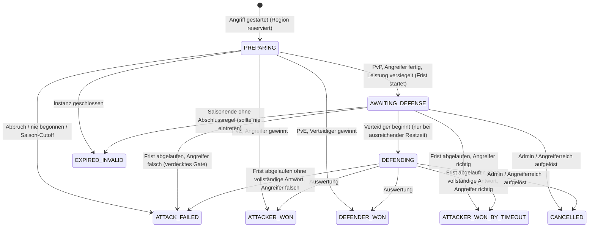
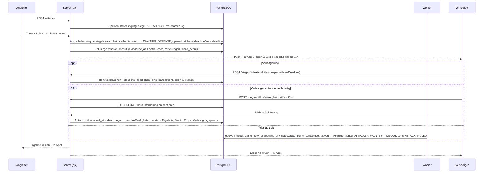

# Belagerungs- und Kampfsystem

Bezug: Brief §5.1, §6.5, §7, §8.8, §12.4, §13.4, §15.2–15.4. Kennzeichnung siehe [README](README.md#kennzeichnung-von-regeln).

## 1. Kampfarten

| Art | Angreifer | Verteidiger | Auswertung | Phase |
|---|---|---|---|---|
| PvE | Spieler | neutrale Garnison oder NPC-Reich | sofort, NPC-Antwort vorab versiegelt | 1 |
| PvP | Spieler | Spieler | Belagerung mit Frist | 2–3 |
| NPC → Spieler | NPC | Spieler | Belagerung mit Frist (Eternal 24 h) | 5 |
| NPC → NPC / neutral | NPC | NPC / neutral | sofort im Worker | 5 |

Alle Arten nutzen dieselbe Tabelle `sieges`, dieselbe Herausforderung (`quiz_challenges`) und dieselbe Auswertungsfunktion `resolveDuel` ([QUIZ_ENGINE.md §8](QUIZ_ENGINE.md#8-duellauswertung)).

## 2. Ablauf PvE (sofortige Auswertung)

1. `POST /attacks` → Berechtigung prüfen, `siege(PREPARING)` anlegen und die Region in derselben Transaktion reservieren ([§3.1](#31-regionsreservierung-e)), Herausforderung auswählen, **NPC-Antworten erzeugen und speichern** (`status = GENERATED`).
2. Spieler beantwortet Trivia und Schätzung.
3. Mit der letzten Antwort wertet der Server in derselben Transaktion aus: Gate → Trivia → Schätzung → Zeit.
4. Bei Sieg: Besitzwechsel, Schutzzeit, Drop-Wurf, Ereignisse. Bei Niederlage: Region bleibt, nichts weiter.

Dass die NPC-Antwort *vor* der Spielerantwort feststeht, ist im Ereignisprotokoll belegbar und schließt jeden Verdacht eines „reagierenden“ NPCs aus [E].

## 3. Zustandsmaschine



| Zustand | Bedeutung | Aktiv? | Brief §7.3 |
|---|---|---|---|
| `PREPARING` | Angreifer bearbeitet die Herausforderung; Region ist reserviert | ja | `ATTACK_PREPARING` |
| – (Ereignis) | Angreifer hat abgegeben | – | `ATTACK_SUBMITTED` – als Ereignis im Protokoll, kein eigener Zustand, da der Übergang atomar ist |
| `ATTACK_FAILED` | Angriff vor Eröffnung abgebrochen (bzw. Saison-Cutoff), **oder** Frist ohne Verteidigung abgelaufen und der Angreifer lag bei der Trivia-Frage falsch (verdecktes Gate, [O-01]); Gebiet bleibt, keine Punkte | nein | **neu** (W-3) |
| `AWAITING_DEFENSE` | Frist läuft, Verteidiger hat noch nicht begonnen | ja | `WAITING_FOR_DEFENDER` |
| `DEFENDING` | Verteidiger bearbeitet die Herausforderung | ja | **neu** (W-3) |
| – (Ereignis) | Verteidiger hat abgegeben | – | `DEFENDER_SUBMITTED` – Auswertung erfolgt in derselben Transaktion |
| `RESOLVING` | reserviert; im MVP nie persistiert, da die Auflösung eine einzige Transaktion ist | ja | `RESOLVING` |
| `ATTACKER_WON`, `DEFENDER_WON`, `ATTACKER_WON_BY_TIMEOUT` | Ergebnisse; jede eigene, vollständige Verteidigung bringt Verteidigungspunkte, auch wenn das Gebiet verloren geht ([GAME_RULES.md §5.5](GAME_RULES.md#55-verteidigungspunkte-v-grundsatz-e-werte-o-18)) | nein | gleichnamig |
| `CANCELLED` | durch Admin oder weil das Angreiferreich nicht mehr aktiv ist; Budget wird erstattet | nein | gleichnamig |
| `EXPIRED_INVALID` | technisches Ende ohne Wertung (Instanz geschlossen) | nein | gleichnamig |

Jeder Übergang ist eine bedingte Aktualisierung (`update sieges set status = :neu, version = version + 1 where id = :id and status = :alt`) und erzeugt einen Eintrag in `battle_events`. Damit ist jeder Übergang höchstens einmal wirksam (Idempotenz, Brief §7.3).

### 3.1 Regionsreservierung [E]

- **Setzen:** Die Transaktion, die die Belagerung in `PREPARING` anlegt, setzt auch `region_state.active_siege_id = :siege` – bedingt mit `… where region_id = :target and active_siege_id is null`. Trifft die Bedingung nicht zu, wird die ganze Transaktion verworfen (`REGION_UNDER_SIEGE`). Der partielle Unique-Index auf `sieges` (N1) bleibt die zweite Absicherung.
- **Freigeben:** Jeder Übergang in einen Endzustand (`ATTACK_FAILED`, `ATTACKER_WON`, `DEFENDER_WON`, `ATTACKER_WON_BY_TIMEOUT`, `CANCELLED`, `EXPIRED_INVALID`) setzt in derselben Transaktion `active_siege_id = NULL`, bedingt auf `active_siege_id = :siege`. Das gilt ausdrücklich auch für PvE-Ergebnisse und für Abbrüche aus `PREPARING` (nie begonnene Herausforderung über `challenge.expireStale`, Abbruch, Saison-Cutoff, Instanzschluss).
- **Prüfung:** Ein Fremdschlüssel stellt sicher, dass der Zeiger auf eine existierende Belagerung genau dieser Region verweist; dass diese Belagerung aktiv ist und jede aktive Belagerung einen Zeiger hat, prüfen Transaktion und Invariantenjob (I3, [DATA_MODEL.md §5](DATA_MODEL.md#5-invarianten)).

## 4. Ablauf PvP-Belagerung



## 5. Nebenläufigkeit und Sperrreihenfolge

### 5.1 Feste Sperrreihenfolge [E]

Jede Transaktion, die mehrere dieser Zeilen verändert, sperrt sie **in genau dieser Reihenfolge** – das verhindert Deadlocks:

1. `kingdoms` (alle beteiligten, aufsteigend nach `id`)
2. `region_state` (aufsteigend nach `region_id`)
3. `sieges`
4. `world_participants` (Inventar-Sperre je Spieler)
5. `player_items`

Ein gemeinsamer Transaktions-Wrapper wiederholt bei Serialisierungs- oder Deadlock-Fehlern (`40001`, `40P01`) bis zu dreimal mit zufälliger Wartezeit; alle Kommandos sind dafür idempotent.

### 5.2 Kritische Wettläufe und ihre Auflösung

| # | Szenario | Auflösung |
|---|---|---|
| N1 | Zwei Angreifer greifen gleichzeitig dieselbe Region an | partieller Unique-Index `sieges_one_active_per_region` – der zweite erhält `REGION_UNDER_SIEGE` |
| N2 | Mehrere Angreifer gegen ein Reich mit 3 offenen Belagerungen | Sperre auf das Verteidigerreich, Zählung inklusive `PREPARING` unter Sperre – der zweite erhält `DEFENDER_SIEGE_LIMIT` (Brief §13.4) |
| N3 | Doppelklick oder Netzwiederholung beim Angriff | `sieges.idempotency_key` unique – gleiche Antwort, keine zweite Belagerung |
| N4 | **Verteidigerantwort gleichzeitig mit Fristablauf** (Brief §12.4) | Einheitliche Fristgrenze ([§6.1](#61-fristgrenze--eine-regel-für-alle-pfade-e)): `received_at` wird beim Eintreffen der Anfrage erfasst, **bevor** auf Sperren gewartet wird; rechtzeitig heißt `received_at < deadline_at`. Ein Timeout wirkt erst ab `deadline_at + settleGrace` und prüft unter Sperre zuerst, ob eine rechtzeitige, vollständige Verteidigung vorliegt – dann wird regulär ausgewertet. Eine rechtzeitig eingetroffene Antwort geht also nicht verloren, weil sie auf die Sperre wartet; eine verspätete wird nie gewertet, auch wenn der Job noch nicht lief. Alle Übergänge sind bedingt; der zweite Pfad sieht einen Endzustand und tut nichts. |
| N5 | Itemverlängerung gleichzeitig mit Fristablauf | Verlängerung nur bei `game_now() < deadline_at` unter Sperre; danach ist der alte Timeout-Job wirkungslos (Frist liegt in der Zukunft) und ein neuer wird geplant |
| N6 | Zwei Verlängerungen auf dieselbe Belagerung | Sperre; die zweite rechnet mit der neuen Frist, wird ggf. gekappt oder abgelehnt (ohne Itemverbrauch) |
| N7 | Dasselbe Item gleichzeitig für zwei Belagerungen | bedingte Aktualisierung `player_items.status AVAILABLE → CONSUMED` + `unique(item_usage.item_id)` – eine Anfrage scheitert mit `ITEM_NOT_AVAILABLE` |
| N8 | Timeout-Job läuft doppelt | Statusvergleich – zweiter Lauf ohne Wirkung |
| N9 | Server-Neustart während laufender Belagerung (E2E-08) | Zustand liegt in Postgres; pg-boss-Jobs sind dauerhaft; Sweeper löst überfällige Belagerungen jede Minute auf; jede Leseanfrage auf eine überfällige Belagerung löst sie ebenfalls auf |
| N10 | Angreiferreich fällt während der Belagerung | Bei Auflösung `CANCELLED`, Region bleibt beim Verteidiger [E] |
| N11 | Admin will eine Region mit aktiver Belagerung ändern | Admin-Werkzeug bricht die Belagerung zuerst ab (`CANCELLED`, protokolliert) |
| N12 | Region wechselt während der Belagerung den Besitzer auf anderem Weg | ausgeschlossen: andere Besitzwechsel prüfen `active_siege_id is null`; Auflösung prüft `owner_kingdom_id IS NOT DISTINCT FROM` erwarteter Verteidiger (neutral: beide `NULL`) |

### 5.3 Auflösungstransaktion

```sql
BEGIN;
-- 1. Sperren in fester Reihenfolge (neutrales Ziel: :def ist NULL, gesperrt wird nur das Angreiferreich)
SELECT id, status, region_count FROM kingdoms WHERE id IN (:att, :def) ORDER BY id FOR UPDATE;
SELECT * FROM region_state WHERE region_id = :target FOR UPDATE;
SELECT * FROM sieges WHERE id = :siege FOR UPDATE;

-- 2. Vorbedingungen (Anwendungscode, bei Nichterfüllung: COMMIT ohne Änderung = idempotentes No-op)
--    PvE: status = PREPARING und beide Schritte des Angreifers abgeschlossen
--    PvP: status ∈ {AWAITING_DEFENSE, DEFENDING}
--    Auslöser DEFENSE: beide Schritte des Verteidigers abgeschlossen, jeweils received_at < deadline_at
--    Auslöser TIMEOUT: game_now() ≥ deadline_at + settleGrace (sonst wurde verlängert) und keine
--                      rechtzeitige vollständige Verteidigung – liegt eine vor, Auswertung wie DEFENSE
--    region_state.owner_kingdom_id IS NOT DISTINCT FROM sieges.defender_kingdom_id  (neutral: beide NULL)
--    region_state.active_siege_id = :siege

-- 3. Entscheidung: game-core.resolveDuel(...)

-- 4. Wirkungen
UPDATE sieges SET status = :final, outcome = :winner, outcome_reason = :reason,
       resolved_at = game_now(), version = version + 1
 WHERE id = :siege AND version = :v;
INSERT INTO battle_results (...);  INSERT INTO battle_events (...);
-- falls Angreifer gewinnt:
UPDATE region_state SET owner_kingdom_id = :att, is_capital = false, owned_since = game_now(),
       protected_until = game_now() + :protection, protection_reason = 'CONQUEST',
       active_siege_id = NULL, version = version + 1, updated_at = game_now()
 WHERE region_id = :target AND owner_kingdom_id IS NOT DISTINCT FROM :def AND active_siege_id = :siege;
UPDATE kingdoms SET region_count = region_count + 1 WHERE id = :att;
-- nur wenn :def nicht NULL (Ziel gehörte einem Reich, nicht neutral):
UPDATE kingdoms SET region_count = region_count - 1 WHERE id = :def;
--   Hauptstadt verloren → neue Hauptstadt wählen; region_count = 0 → Reich FALLEN
INSERT INTO region_history (...);   -- from_kingdom_id = :def (NULL bei neutralem Ziel)
--   Drop-Wurf → reward_events (+ player_items)
-- falls Verteidiger gewinnt (DEFENDER_WON) oder Angriff am verdeckten Gate scheitert (ATTACK_FAILED):
UPDATE region_state SET active_siege_id = NULL, version = version + 1
 WHERE region_id = :target AND active_siege_id = :siege;
-- Verteidigungspunkte, unabhängig vom Ausgang: nur wenn :points = game-core.defensePoints(...) > 0,
--   der Verteidiger ein Spielerreich ist, das Paarlimit nicht erreicht und die Konten nicht verdächtig verknüpft sind:
UPDATE kingdom_statistics SET defense_points = defense_points + :points WHERE kingdom_id = :def;
UPDATE player_statistics  SET defense_points = defense_points + :points WHERE user_id = :defender_user;
-- immer:
INSERT INTO world_events (...);  INSERT INTO notifications (...);
COMMIT;
```

Erst nach dem Commit werden Push-Benachrichtigungen versendet (eigener Job, liest `notifications`). Fällt der Versand aus, bleibt der Spielzustand korrekt.

## 6. Fristen und Verlängerungen

Bei Eröffnung werden die Fristwerte aus der Regelkonfiguration in die Belagerung kopiert (`rules_snapshot`), damit spätere Regeländerungen nicht rückwirkend wirken [E]:

```
opened_at        = game_now()
base_deadline_at = opened_at + defense.baseDeadline            // 24 h [V]
deadline_at      = base_deadline_at
max_deadline_at  = opened_at + defense.maxDeadline             // 48 h [A]
```

### 6.1 Fristgrenze – eine Regel für alle Pfade [E]

- **Exklusive Grenze:** Eine Verteidigerantwort ist rechtzeitig genau dann, wenn `received_at < deadline_at`. Dieselbe Regel gilt für das Zeitlimit jeder Einzelfrage (`received_at < answer_deadline_at`, [QUIZ_ENGINE.md §7](QUIZ_ENGINE.md#7-herausforderungsprotokoll)). Verlängern und Verteidigung beginnen sind nur bei `game_now() < deadline_at` erlaubt.
- **Eingangszeit vor der Sperre:** `received_at` wird als erste Anweisung der Anfrage gesetzt (`game_now()`), bevor auf Zeilensperren gewartet wird, und mit der Antwort gespeichert. Interne Wiederholungen nach `40001`/`40P01` verwenden denselben Wert. Wartezeit auf Sperren geht so nie zulasten des Spielers.
- **Abwicklungspuffer:** Ein Timeout wirkt erst, wenn `game_now() ≥ deadline_at + defense.settleGrace` (Standard 5 s) und unter Sperre keine rechtzeitige, vollständige Verteidigung vorliegt. Antwort-Endpunkte haben eine harte Laufzeitgrenze (`lock_timeout`/`statement_timeout`, gesamt ≤ 3 s) unterhalb von `settleGrace`. Eine vor der Frist eingetroffene Antwort ist deshalb gespeichert und ausgewertet, bevor ein Timeout wirken kann.
- **Ein Prädikat:** Timeout-Job, Sweeper und Auflösung beim Lesen verwenden dieselbe Funktion `isTimeoutDue(siege, now) = now ≥ deadline_at + settleGrace` aus `game-core`.
- Die Oberfläche zeigt immer `deadline_at`. `settleGrace` ist nur ein technischer Puffer und verlängert die Frist für niemanden.

### 6.2 Verteidigung beginnen

**Verteidigung beginnen** ist nur erlaubt, wenn `deadline_at − game_now() ≥ Σ(Zeitlimits + cap) + startBuffer` (≈ 61 s) [E]. Sonst erhält der Spieler `DEADLINE_TOO_CLOSE` und – falls vorhanden – den Hinweis, dass ein Item die Frist noch verlängern kann.

### 6.3 Verlängerung

**Verlängerung** (`POST /sieges/:id/extend`), alles in einer Transaktion [V-nah, Brief §8.8]:

1. Sperren: Verteidigerreich → Region → Belagerung → Teilnehmerzeile des Spielers → Item.
2. Prüfen: Belagerung `AWAITING_DEFENSE` oder `DEFENDING`; `game_now() < deadline_at` (abgelaufen kann nicht wieder geöffnet werden); Spieler ist Besitzer des Verteidigerreichs; Region gehört noch dem Verteidigerreich; Item gehört dem Spieler, Status `AVAILABLE`, Typ zulässig in diesem Modus; Idempotenzschlüssel unbekannt.
3. Berechnen: `neu = min(deadline_at + effect, max_deadline_at)`. Ist `neu = deadline_at` (Obergrenze erreicht) → `EXTENSION_LIMIT_REACHED`, **kein Itemverbrauch** (E2E-07).
4. Vergleich mit `expectedNewDeadline` aus der Anfrage (der Client hat dem Spieler diesen Wert vor der Bestätigung gezeigt, Brief §15.3). Abweichung → `DEADLINE_CHANGED`, kein Verbrauch, Client zeigt neuen Vorschlag.
5. Schreiben: Item `CONSUMED`, `item_usage`, `inventory_transactions`, `sieges.deadline_at = neu`, `battle_events`, `world_events`; Timeout-Job auf neue Frist planen.

## 7. Limits und Schutz – Zählregeln

| Limit | Zählweise |
|---|---|
| PvP-Belagerungen pro Angreifer | Belagerungen mit `mode = PVP`, `attacker_kingdom_id` des Spielers, `opened_at > game_now() − 24 h` (gleitend); jeder abgeschlossene Angriff eröffnet eine Belagerung, auch bei falscher Antwort |
| PvP-Versuche pro Angreifer | wie oben, aber `attack_presented_at` statt `opened_at` (auch gescheiterte) |
| Offene Belagerungen gegen ein Reich | Status `PREPARING`, `AWAITING_DEFENSE`, `DEFENDING` mit `defender_kingdom_id` des Reichs – **über alle Angreifer** einschließlich NPCs (Brief §7.4 letzter Punkt; NPC-Kontingent zusätzlich nach [O-13]) |
| Schutz nach Eroberung | `region_state.protected_until`; gilt gegen alle, auch den Vorbesitzer |
| Anfänger-/Wiederaufbauschutz | `kingdoms.protected_until`; endet vorzeitig, sobald das Reich selbst einen Spieler angreift (UI warnt vorher) |
| Rangabstand | geprüft beim Angriffsstart mit `region_count` beider Reiche |
| Punktbringende Verteidigungen je Paar | `battle_results` mit `defense_points > 0` für dasselbe Paar aus Angreifer- und Verteidigerreich in den letzten 24 h (gleitend), Grenze `defense.pointsPairLimitPerDay` |

Alle Zählungen erfolgen unter Sperre des betroffenen Reichs; parallele Anfragen können Limits nicht umgehen (Brief §13.4).

## 8. Hauptstadt und Totalverlust in der Auflösung

- Verliert der Verteidiger seine Hauptstadt und hat noch Regionen: neue Hauptstadt nach [GAME_RULES.md §3](GAME_RULES.md#3-königreich-hauptstadt-ränge-totalverlust), Eintrag in `kingdom_history`, Mitteilung.
- Sinkt `region_count` auf 0: Reich `FALLEN`, offene ausgehende Belagerungen des Reichs werden bei ihrer Auflösung `CANCELLED`, Spieler erhält eine Niederlagenmeldung mit Rückblick (größte Ausdehnung, gewonnene Kämpfe) und den Button „Neues Reich gründen“ (Brief §15.4).

## 9. Belagerungs-Dashboard

- Liste aller offenen eingehenden Belagerungen, sortiert nach verbleibender Zeit (dringendste zuerst, Brief §11.4); Hauptstadt und strategisch wertvolle Regionen hervorgehoben.
- Je Eintrag: Region, angreifendes Reich, Restzeit (Server-basiert), Status, Buttons „Verteidigen“ und „Item verwenden“ mit Vorschau der neuen Frist.
- Darunter: kürzlich abgeschlossene Konflikte mit Ergebnis und Link zur Auflösung.
- Mobil: eigener Tab in der unteren Navigationsleiste mit Zähler-Badge.

## 10. Benachrichtigungen

| Ereignis | In-App | Web Push ([O-04]) |
|---|---|---|
| Belagerung gegen mich eröffnet | ✓ | ✓ sofort |
| Frist endet in 6 h (bzw. konfigurierbar) und noch keine Verteidigung | ✓ | ✓ |
| Frist endet in 1 h | ✓ | ✓ |
| Frist verlängert (manuell oder automatisch) | ✓ | ✓ bei automatischer Verlängerung |
| Belagerung aufgelöst (beide Seiten) | ✓ | ✓ |
| Item erhalten / Ablage läuft ab | ✓ | – |

Ruhezeiten pausieren nur Benachrichtigungen, **nie** Fristen. Dies wird in den Einstellungen deutlich erklärt.

## 11. Admin-Eingriffe

- Belagerung abbrechen (`CANCELLED`, Begründung Pflicht, Budget erstattet, beide Seiten informiert).
- Fehlerhafte Frage in laufender Belagerung: Abbruch wie oben; Frage wird suspendiert.
- Fehlerhafte Frage in abgeschlossenem Kampf: Ergebnis bleibt bestehen; Rückabwicklung nur in begründeten Einzelfällen über ein eigenes, protokolliertes Werkzeug, das einen Gegen-Besitzwechsel mit Ursache `ADMIN` schreibt (nie Protokolle löschen).
- Alle Eingriffe erzeugen `audit_events` (Brief §13.5).
