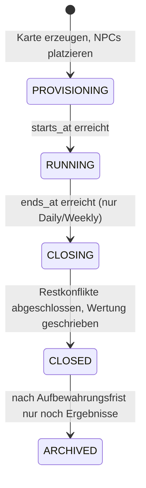

# Weltsystem und Skalierungsstrategie

Bezug: Brief §3, §4.1, §10, §12.6, §19 A/C/D/H/I. Kennzeichnung siehe [README](README.md#kennzeichnung-von-regeln).

## 1. Weltarten im Überblick

| Eigenschaft | Eternal | Weekly | Daily |
|---|---|---|---|
| Laufzeit | unbegrenzt [V] | 7 Tage [A] | 24 h [A] |
| Spieler pro Instanz | wachsend, Tausende | 100–300 [A] | 20–50 [A] |
| Karte | wachsend in Chunks | ≈ 12 Regionen/Spieler + NPC (≈ 2 000–4 000) [E] | ≈ 10 Regionen/Spieler + NPC (≈ 300–600) [E] |
| PvP-Frist | 24 h [V], max. 48 h mit Items [A] | 4 h [A] | 15 min [A] |
| Items | ja | nein [E] | nein [E] |
| Startbedingungen | fairer Einstieg in Startzonen | gleichberechtigt, symmetrische Startpositionen | gleichberechtigt, symmetrische Startpositionen |
| Ende | – | Saisonabschluss, Rangliste, Archiv | Tagesabschluss, Rangliste, Archiv |
| Belohnungen | Fortschritt im Reich, Items | kosmetisch (Abzeichen, Titel) | kosmetisch |

## 2. Instanzmodell

- `worlds` beschreibt das Angebot (z. B. „Eternal Europa“, „Tageskarte“), `world_rules` die versionierte Regelkonfiguration, `world_seasons` den Zeitraum (Daily/Weekly), `world_instances` die konkrete Karte.
- Eine Weekly-Saison kann mehrere parallele Instanzen haben (Shards), die alle dieselben Regeln nutzen.
- **Welttrennung** [V, Brief §3.4]: Jede Spielzeile hängt an genau einer Instanz; jede Abfrage und jedes Kommando ist auf `instance_id` beschränkt; Itemdefinitionen tragen `allowed_modes`, Inventare sind pro Instanz. Ein Invariantenjob prüft, dass keine Beziehung Instanzgrenzen überschreitet (E2E-12).
- Globale Profile, Statistiken und kosmetische Errungenschaften sind weltübergreifend (an `users` gebunden), verschaffen aber keine Spielvorteile.

## 3. Karte, Chunks und Erzeugung

### 3.1 Koordinaten

- Axiale Koordinaten `(q, r)`, pointy-top [A]. Speicherung und alle Regeln (Nachbarschaft, Distanz) in axialen Koordinaten.
- **Chunks** werden in Offset-Koordinaten gebildet („odd-r“: `col = q + (r − (r & 1)) / 2`, `row = r`), damit sie auf dem Bildschirm Rechtecke ergeben: `chunk_x = floor(col / 16)`, `chunk_y = floor(row / 16)` → 256 Regionen pro Chunk [E].
- Distanz: `(|dq| + |dr| + |dq + dr|) / 2`.

### 3.2 Prozedurale Erzeugung [E]

Deterministisch aus `map_seed` und Chunk-Koordinate (jeder Chunk ist einzeln erzeugbar, unabhängig von der Reihenfolge):

1. **Gelände:** Rauschfunktion (Simplex) → Biom (Ebene, Wald, Hügel, Gebirge, Küste, Wüste, Tundra). Wasserfelder sind keine Regionen (natürliche Grenzen, strategische Engpässe).
2. **Regionsstufe (`tier`):** wächst mit Entfernung von Startzonen und Nähe zu schweren NPC-Hauptstädten. Startzonen: Stufe 0–2.
3. **NPC-Fraktionen:** je Chunk-Gruppe eine Mischung leichter, mittlerer und schwerer Fraktionen mit zusammenhängenden Gebieten (Brief §6.1); schwere Fraktionen bevorzugt im Inneren älterer Ringe.
4. **Neutrale Regionen:** alles Übrige; neutrale Garnisonen erhalten Stärke nach `tier`.
5. **Startkandidaten:** Regionen, die die Spawn-Kriterien (§4.2) erfüllen, werden in einer Kandidatenliste geführt und laufend aktualisiert.

Eine Region ist im Datenmodell eine Zeile in `regions` (statisch) plus eine in `region_state` (dynamisch). Erzeugte Chunks werden vollständig materialisiert; nur sie existieren für das Spiel.

### 3.3 Darstellung großer Karten

- Statische Chunk-Daten sind unveränderlich und lange cachebar; dynamischer Zustand wird pro Chunk und als Delta übertragen ([API.md §2.2](API.md#22-welten-und-karte)).
- Client lädt nur Chunks im Viewport plus einen Rand; weit herausgezoomt zeigt er eine Übersicht je Chunk (dominanter Besitzer, Konfliktmarker) statt einzelner Hexfelder.
- Server liefert Chunk-Zustände aus `region_state` über den Index `(instance_id, chunk_x, chunk_y)`; häufig gelesene Chunks können später in einem Prozess-Cache mit Invalidierung über `world_events` gehalten werden.

## 4. Eternal: Wachstum und Einstieg

### 4.1 Wachstumsregel (Chunk-Freischaltung) [E]

Die Welt beginnt mit einem Kern aus 3 × 3 Chunks (2 304 Regionen, davon nach Abzug von Wasser ≈ 2 000 spielbar). Sie wächst in **Ringen** um den Kern (Ring k hat 8·k Chunks). Ein neuer Ring wird freigeschaltet, wenn eine der Bedingungen erfüllt ist:

- freie Startkandidaten < 3 × durchschnittliche Neuanmeldungen der letzten 7 Tage, oder
- Anteil spielerbesetzter Regionen in den äußersten Chunks > 50 %.

Die Freischaltung ist ein Worker-Job: Chunks erzeugen, NPCs platzieren, Startkandidaten berechnen, Ereignis `world.expanded`. Neue Spieler starten bevorzugt im äußersten Ring – erfahrene Reiche liegen weiter innen. Die Freischaltung ist rein additiv und damit risikoarm.

### 4.2 Startregion für neue Spieler [E]

Kandidaten müssen erfüllen:

- neutral, Stufe ≤ 2, nicht unter Belagerung,
- mindestens 4 neutrale Regionen im Radius 2 (Raum für die ersten Eroberungen),
- mindestens 1 leichte NPC-Fraktion im Radius 8 (Brief §10.1),
- Abstand ≥ 6 zu Reichen mit ≥ 15 Regionen und ≥ 3 zu jeder anderen Spielerhauptstadt (Schutz vor unmittelbarer Übermacht).

Unter den Kandidaten wird nach Punktwert (freier Raum, Nähe zu anderen Neulingen für spätere Interaktion, Abstand zu Großreichen) die beste gewählt; Gleichstand per Zufallsstrom. Zusätzlich gilt der Anfängerschutz und der Rangabstandsschutz ([GAME_RULES.md §7](GAME_RULES.md#7-limits-und-schutzzeiten)) – zusammen erfüllen sie „Große Königreiche dürfen Anfängergebiete nicht unmittelbar vollständig kontrollieren“ (Brief §10.1).

Gleiche Kriterien gelten für den Neustart nach Totalverlust (Brief §4.5).

### 4.3 Kapazitätsabschätzung (Hypothese, durch Lasttests zu bestätigen)

| Annahme | Wert |
|---|---|
| Aktive Spieler | 10 000 |
| Ø Regionen pro aktivem Spieler | 30 |
| Anteil NPC/neutral/inaktiv | 2× Spieleranteil |
| ⇒ Regionen gesamt | ≈ 900 000 (≈ 3 500 Chunks, ≈ Ring 20) |
| `region_state`-Zeilen | ≈ 0,9 Mio. – unkritisch für Postgres |
| Besitzwechsel pro Tag | ≈ 150 000 (PvE + PvP + NPC) ≈ 2/s im Mittel |
| Offene Belagerungen gleichzeitig | ≤ 40 000 (4 pro Reich als Obergrenze, real deutlich weniger) |

Die Datenbank ist bei dieser Größe nicht der Engpass; kritisch sind Client-Rendering (gelöst durch Chunking/LOD) und die Zahl gleichzeitiger WebSocket-Verbindungen (gelöst durch mehrere API-Knoten).

## 5. Inaktivität und Rückführung (Vorschlag zu [O-15])

Grundsatz aus Brief §3.1 / §19 C: kurze Offlinezeiten dürfen nicht den gesamten Fortschritt kosten; jahrelang verlassene Reiche dürfen die Welt aber nicht blockieren. Vorschlag [E]:

| Stufe | Bedingung (kein Login seit) | Wirkung |
|---|---|---|
| aktiv | < 7 Tage | normal |
| ruhend | 7–30 Tage | Reich auf der Karte als „ruhend“ markiert (für andere sichtbar, lädt zum Angriff ein); normale Belagerungen und Timeouts gelten weiter |
| verfallend | 30–180 Tage | Täglich wird **eine** Randregion neutral (von außen nach innen); Hauptstadt und ihre direkten Nachbarn bleiben erhalten |
| aufgelöst | > 180 Tage | Restliche Regionen werden neutral, Reich `DISSOLVED`; Konto, Statistik, Historie bleiben bestehen |
| Rückkehr | Login nach ≥ 7 Tagen | 24 h Rückkehrerschutz; was noch da ist, bleibt; bei Totalverlust normaler Neustart |

Regionen unter Belagerung werden vom Verfall übersprungen. Verfall erzeugt `region_history` mit Ursache `DECAY`. Unabhängig davon können Konten nach sehr langer Inaktivität (z. B. 3 Jahre, nach Vorankündigung per E-Mail falls vorhanden) aus Datenschutzgründen gelöscht werden ([SECURITY.md §5](SECURITY.md#5-datenschutz-dsgvo)).

## 6. Daily und Weekly

### 6.1 Zeitplan und Beitritt [E]

- Daily startet täglich um 04:00 Europe/Berlin (gleiche Zeitzone wie Ungarn), Weekly montags 04:00. Uhrzeit konfigurierbar.
- Instanzen werden bei Bedarf erzeugt: Spieler werden in die jüngste nicht volle Instanz eingeteilt; ist keine frei, wird eine neue vorbereitet (Karte wird für die aktuelle Spielerzahl aus einer Vorlage skaliert).
- Beitritt Daily bis 12 h vor Ende, Weekly bis Tag 5; danach nur mit deutlichem Hinweis auf die Restlaufzeit (Brief §10.2). Für Weekly ist eine Spielstärke-Einteilung (θ aus [QUIZ_ENGINE.md §10](QUIZ_ENGINE.md#10-kalibrierung-und-spielstärke)) vorbereitet, aber im ersten Schritt aus.
- Gleichberechtigter Start: symmetrisch verteilte Startpositionen mit identischer Umgebung (gleiche Anzahl neutraler Nachbarn, gleiche NPC-Abstände).

### 6.2 Saisonende ohne offene Konflikte (W-14, Vorschlag zu [O-16])

- **PvP-Angriffsschluss** = `ends_at − defense.baseDeadline` (Weekly: letzte 4 h, Daily: letzte 15 min). Danach sind nur noch PvE-Eroberungen möglich. So endet jede PvP-Belagerung spätestens zum Saisonende und es entstehen keine Konflikte mit Fälligkeit nach Saisonende (Brief §3.3).
- Bei `ends_at`: Instanz `CLOSING`; laufende PvE-Herausforderungen werden noch bis zu ihrem Zeitlimit angenommen; danach `EXPIRED_INVALID` für Reste (sollte nicht vorkommen), Wertung, `season_results`, `CLOSED`.
- Die UI kündigt Angriffsschluss und Saisonende mit Countdown an.

### 6.3 Wertung (Vorschlag, transparent) [E]

| Quelle | Punkte |
|---|---|
| Gehaltene Region am Saisonende | 10 |
| Gehaltene Hauptstadt | +20 |
| Gewonnener PvP-Kampf (Angriff oder Verteidigung) | 5 |
| Eroberte NPC-Region | 2 |

Gleichstand: mehr gehaltene Regionen → früher erreichter Endpunktestand. Die Punkteformel steht im Spiel sichtbar beim Ranglisten-Button.

### 6.4 Live-Duelle

Brief §3.2 schlägt für Daily „schnelle Live-Duelle“ vor. Das asynchrone Protokoll funktioniert mit 15-min-Frist bereits für Daily. Echte synchrone Duelle (beide gleichzeitig, mit Matchmaking) sind ein eigenes Feature mit eigener Infrastruktur und werden als [O-17] nach Phase 6 vorgeschlagen.
